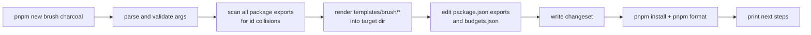

# Contributing a plugin

> **Status: design.** The generator (`pnpm new`), the `@sketchy-js/testkit` suite (`describePlugin`), and `packages/contrib` described here do not exist yet; they are the target interface for contributors. What does exist is the plugin contract (API 1.0) and a set of conformance helpers in `@sketchy-js/plugin`; [section 3](#3-the-conformance-suite) says exactly which checks those cover. Read [plugins.md](plugins.md) first; this guide assumes you know the four plugin kinds and the purity contract.

This is a walkthrough from idea to merged pull request. For general repository rules (setup, commits, code style) see [CONTRIBUTING.md](../CONTRIBUTING.md).

## Contents

1. [Before you start](#1-before-you-start)
2. [The `pnpm new` generator](#2-the-pnpm-new-generator)
3. [The conformance suite](#3-the-conformance-suite)
4. [`packages/contrib`](#4-packagescontrib)
5. [Graduation from contrib to core](#5-graduation-from-contrib-to-core)
6. [Pull request template and checklist](#6-pull-request-template-and-checklist)
7. [Troubleshooting](#7-troubleshooting)

## 1. Before you start

1. **Pick the kind.**

   | You want to change | Kind | Generator argument |
   | --- | --- | --- |
   | How a stroke is painted (wax, ink bleed, dry media, pen with pressure) | brush | `brush` |
   | What fills a shape's interior (hatching variants, stippling, washes) | fill | `fill` |
   | Marks drawn on a sticker's paper (fibers, cracks, weave, speckle) | texture | `texture` |
   | The cut edge of a sticker (pinked, scalloped, torn) | sticker edge | `edge` |

   Something else (new shapes, joins, sticker silhouette logic, an image-based look) is a core change, not a plugin. Open an issue first. `StickerImage` is not extensible by plugins ([why](plugins.md#84-why-stickerimage-is-not-a-plugin)).

2. **Search the [gallery](plugins.md#52-what-the-schema-drives) and open issues** for an existing plugin that an option could extend. A new `style` choice on an existing plugin is often better than a near-duplicate.

3. **Choose a home.**
   - `packages/contrib` in this repo: the default for anything new. Reviewed to the same technical bar as core, with lighter process and an `experimental` status.
   - Your own npm package (`sketchy-plugin-<name>`, keyword `sketchy-plugin`): fully supported. Use `@sketchy-js/testkit` as a dev dependency to run the same conformance suite on your own CI. Open a PR adding it to the gallery's community list if you want it listed.
   - Built-in packages (`brushes`, `fills`, `stickers`): only by [graduation](#5-graduation-from-contrib-to-core) or by maintainers, because built-ins carry Swift-parity and size commitments.

4. **Read the contract** ([purity rules](plugins.md#3-the-purity-contract-and-how-it-is-enforced)). If your idea needs pixels, blur, blend modes, or other plugins, it does not fit the contract yet; discuss it in an issue.

## 2. The `pnpm new` generator

```bash
pnpm new <brush|fill|texture|edge> <name> [flags]
```

Examples:

```bash
pnpm new brush charcoal
pnpm new fill stipple --author "Ada Lovelace"
pnpm new edge pinking --dry-run
```

`<name>` is kebab-case, 2 to 32 characters. The plugin id becomes `contrib/<name>`.

| Flag | Default | Meaning |
| --- | --- | --- |
| `--dry-run` | off | Print every file that would be created or changed and exit |
| `--pkg <contrib\|brushes\|fills\|stickers>` | `contrib` | Target package. Anything other than `contrib` requires a maintainer-approved issue (`--approved-by <issue>`), and the id has no `contrib/` prefix |
| `--author <name>` | from `git config` | Written to the docs front matter and changeset |
| `--description <text>` | prompt | One-line plugin description |
| `--no-install` | off | Skip the final `pnpm install` and format step |

### 2.1 What it creates

For `pnpm new brush charcoal`:

```text
packages/contrib/src/brushes/charcoal/
  charcoal.ts          plugin, with a working placeholder implementation
  charcoal.test.ts     plugin-specific tests (the conformance suite runs separately)
  charcoal.demo.ts     demo samples consumed by the playground and gallery
  charcoal.doc.md      docs prose and front matter
  index.ts             re-export for the subpath export
.changeset/<generated-name>.md
```

| File | Purpose | Starts as |
| --- | --- | --- |
| `charcoal.ts` | `defineBrush({...})` with `/*#__PURE__*/`, a minimal schema (one `number` option), and an implementation that returns a plain ribbon so the plugin already renders | Compiles, passes every conformance check, looks boring on purpose |
| `charcoal.test.ts` | Vitest file with one `runBrush` smoke test and `it.todo` entries for behavior you should specify | Runs green |
| `charcoal.demo.ts` | `defineDemo(plugin, { geometry, strokeWidth })`; samples default to the plugin's `examples` | Uses the standard fixtures |
| `charcoal.doc.md` | Front matter (`plugin`, `kind`, `status: experimental`, `author`) and two prose headings. The option table is generated from the schema | Placeholder text that fails the docs check until replaced |
| `index.ts` | `export { charcoal } from "./charcoal"; export { charcoal as default } from "./charcoal";` | Generated |
| changeset | `@sketchy-js/contrib: minor` with "Add contrib/charcoal brush" | Generated |

### 2.2 What it changes

- Adds `"./brushes/charcoal": { "types": ..., "import": ... }` to `packages/contrib/package.json` `exports`.
- Adds `"contrib/charcoal": { "gzip": 3072 }` to `packages/contrib/budgets.json` using the default budget for the kind (see [size budget](#35-size-budget)).
- Does **not** edit any barrel, registry, docs index, or gallery list. The docs and gallery builds discover plugins by globbing `*.doc.md` and `*.demo.ts`, so there is no manual wiring to forget.

### 2.3 Safety rules

The generator refuses to run when the name is not kebab-case, the id already exists in any package (it scans exports of every package, not just contrib), the directory exists, the git working tree has unrelated staged changes, or `--pkg` is not `contrib` without `--approved-by`. It never overwrites a file. After writing it runs `pnpm install` (to link the new export) and `pnpm format` on the new files, then prints the next steps:

```text
Created contrib/charcoal (brush) in packages/contrib/src/brushes/charcoal

Next:
  1. pnpm dev                      open the playground; your plugin is listed under Brushes
  2. edit charcoal.ts              implement generate(); keep it pure (no Math.random!)
  3. pnpm test charcoal            conformance + your tests, watch mode
  4. pnpm docs:plugins             check the generated docs page
  5. pnpm check charcoal           lint + types + tests + budget, the same as CI
```

### 2.4 How it works (for maintainers)

`tools/new-plugin/` contains a small script (`tsx`) and one template directory per kind under `tools/templates/<kind>/`. Templates are real, type-checked TypeScript files with `__NAME__`, `__ID__`, and `__CAMEL__` tokens, and a CI job instantiates every template with a throwaway name and runs the full check on the result, so the generator cannot rot. Adding a fifth plugin kind in a future API major means adding a template directory and a conformance corpus; nothing else.

Request routing for `pnpm new`:



## 3. The conformance suite

### 3.0 What is implemented today

The suite below is the **target**. Today the repository has individual helper functions exported from `@sketchy-js/plugin` (`packages/plugin/src/conformance.ts`, tests in `packages/plugin/test/conformance.test.ts`). Each throws on failure, so it works in any test runner, and a plugin's own test file calls them directly. There is no `describePlugin`, no auto-discovery, no `expectedFailures`, and no gallery or snapshot machinery yet.

| Guarantee | Status | Helper or note |
| --- | --- | --- |
| Repeatability: same call twice gives identical JSON | Implemented | `assertDeterministic(generate)` (also runs under the guard below) |
| No unseeded randomness or clock reads | Implemented for `Math.random`, `Date.now`, `performance.now`, `crypto.getRandomValues`, `crypto.randomUUID` | `withRandomGuard(callback)` replaces them with throwing functions and always restores them |
| Global replacement of `new Date()` with no arguments, `document`, `window`, `Path2D`, `OffscreenCanvas`, `fetch` | Planned | Needs a `Date` shim and a runner with those globals defined |
| Frozen inputs and no output aliasing | Implemented | `assertInputImmutable(generate, input)` runs `generate` on a deep-frozen structural copy and fails on a write or on output that reuses an input object or array |
| Interleaving: A, B, A gives the same A | Implemented for a pair of calls | `assertInterleavingStable(a, b)`. Planned: checking two instances with different overrides automatically |
| Output budget | Implemented | `assertWithinBudget(output, maxOps)` counts path operations and requires finite numbers. Planned: the `overflow` bound check |
| Import graph limited to relative files and `@sketchy-js/plugin` | Planned | Needs the esbuild metafile; also the empty-bundle tree-shaking check |
| Fresh module (`vi.resetModules()` and re-import) | Planned | |
| Seed sensitivity and `stochastic: false` verification | Planned | Needs a call-counting RNG |
| Option-order independence, dead-option detection | Planned | |
| Contract and metadata checks (id pattern, semver, `api` support, examples, length limits) | Partly | Schema and definition validation exist as `validateSchema` and `validateDefinition` in `@sketchy-js/plugin/schema`, and `defineX` runs them outside production. The registry calls `assertPluginApi` at `use()`. Examples, id pattern, and length limits are not checked |
| Edge-case corpus per kind, all-min and all-max options, pairwise sampling | Planned | The nine built-in fills have a hand-written subset in `packages/scene/test/fills-conformance.test.ts` (degenerate and far-off regions, angles, huge and tiny gaps, determinism, metadata) |
| Cross-platform snapshots, SVG vs Canvas visual parity | Planned | Built-in fills are compared with the Swift reference fixtures instead |

### The target suite

Everything from here to the end of this section describes the target suite and is not implemented except as listed above.

Every plugin must pass the same automatic suite, from `@sketchy-js/testkit`. You do not write it and cannot forget it:

- A repo-level test, `packages/*/plugins.conformance.test.ts`, discovers every plugin module (any module matching `src/**/<kind>s/<name>/<name>.ts` whose default export carries the `"~sketchy"` brand) and runs `describePlugin(plugin, options)` on it. A plugin that exists in the tree is tested.
- A second meta-test fails if a discovered plugin module has no `.demo.ts`, no `.doc.md`, or no `budgets.json` entry.
- Opting out of a check is only possible through `expectedFailures` in the plugin's test with a linked issue; maintainers review each one, and the suite reports them in the PR summary.

Run it locally:

```bash
pnpm test charcoal          # conformance + plugin tests for one plugin
pnpm test:visual charcoal   # SVG vs Canvas raster parity (needs Playwright browsers)
pnpm check charcoal         # lint, types, tests, size budget
```

### 3.1 Contract and metadata

- `id` matches the allowed pattern and namespace for its package; `version` is valid semver; `api` is supported by the host.
- Schema validity: defaults inside `[min, max]`, `min <= max`, enum defaults in `values`, unique keys, every option has a `description`, `int` options have integer defaults.
- At least one `examples` entry; every example validates under `strict` option resolution.
- `title` and `description` are non-empty and under length limits (the gallery truncates).
- The plugin module has no side effects: bundling `import "<entry>"` alone yields an empty bundle, and bundling the named import includes no other plugin.

### 3.2 Purity and determinism

**No `Math.random` (or any other nondeterminism).** Three independent checks:

1. Lint rejects `Math.random`, `Date`, `performance`, `crypto`, and platform globals in plugin modules.
2. At runtime the suite replaces `Math.random`, `Date.now`, `new Date()` with no arguments, `performance.now`, `crypto.getRandomValues`, `crypto.randomUUID`, `document`, `window`, `Path2D`, and `OffscreenCanvas` with throwing getters while `generate` runs. Aliased or computed access (`Math["random"]`, `const r = Math.random`) is caught here.
3. The import graph of the plugin module (via the esbuild metafile) may contain only relative files and `@sketchy-js/plugin`.

**Determinism per seed.**

| Check | What is compared |
| --- | --- |
| Repeat | The same `(input, options, seed)` five times in one process gives byte-identical canonical JSON |
| Fresh module | Same result after `vi.resetModules()` and re-import, catching module-level state |
| Interleaving | Call A(seed 1), B(seed 2), A(seed 1) gives the same A both times; two plugin instances with different overrides do not influence each other |
| Seed sensitivity | For stochastic plugins, 20 different seeds produce at least 2 distinct outputs; for `stochastic: false`, `ctx.rng` is never called and all seeds give identical output |
| Option-order independence | `with({ a, b })` equals `with({ b, a })` |
| No dead options | For every option, moving it from default to min or max changes output on at least one corpus fixture. A failure means the option is unused or its range is wrong. If it only matters on geometry outside the corpus, pass `describePlugin(plugin, { extraFixtures })` |
| Input immutability | Inputs are deep-frozen; any mutation throws. Output arrays must not alias input arrays |
| Cross-platform | Committed snapshots must match on the Linux, macOS, and Windows CI jobs. Comparison is numeric with a tolerance of `5e-4` px, because transcendental functions can differ in the last bit across engines |

### 3.3 Edge cases

Each kind runs a fixed corpus at default options, at all-min and all-max option combinations, and on a seeded pairwise sample of option combinations. For every case the requirements are the same: **does not throw, returns only finite numbers, produces well-formed paths, stays within `ctx.maxOps` and within `overflow` of the input bounds.** Empty output is valid.

| Kind | Corpus |
| --- | --- |
| brush | empty path; lone `M`; `M` + `L` to the same point (zero length); two coincident points; very short segment (1e-9); collinear points; straight line; closed path; closed path with duplicate closing point; self-crossing figure eight; 180-degree reversal (cusp); tight curl; huge coordinates (1e6); negative coordinates; multi-subpath mix of open and closed; 10,000 segments; stroke width 0, 0.01, and 1,000; unit `miterLimit` |
| fill | zero-area region (collinear ring); region with zero width or height; thin sliver (0.01 px); concave "C" shape; ring with a hole; nested holes; two disjoint rings; region far from origin (1e6); `gap` larger than the region; `gap` 0.1 (op-budget stress); `angle` 0, 45, 90, -45, 720 |
| texture | sheet 0.5 px across; sheet 5,000 px across (op budget); sheet with holes; ring-shaped sheet; zero `margin` |
| edge | triangle (3 points); contour with duplicate consecutive points; collinear points; very short edges (1e-6); clockwise and counter-clockwise rings; ring with hole; tiny margin (0.1) and huge margin (200); all points flagged as corners and none flagged |

Additional kind rules:

- **Edge plugins** must return closed rings with at least 3 distinct points. The host validates self-intersection; the suite asserts that either the output is valid or the plugin reports `ctx.warn("edge-invalid", ...)` and returns the input rings unchanged, so the host fallback is rarely the thing that saves you.
- **Texture plugins** are tested with the host clip disabled to verify marks stay within `overflow` of the sheet bounds.
- **Fill plugins** must return the same number of `strokes` or `area` parts regardless of `clip`; clipping is the host's job.

### 3.4 Snapshot render

For every `(fixture, example)` pair the suite runs the plugin through the testkit host, builds a `Scene`, renders it with `@sketchy-js/svg-renderer` at a fixed size and device scale, normalizes the SVG (numbers to 3 decimals, attribute order, ids), and compares against `__snapshots__/<name>/<fixture>-<example>.svg` using a tolerant numeric comparator.

- First run writes snapshots and fails with "snapshots written, review and commit".
- `pnpm test -u charcoal` updates them. **Every snapshot diff in a PR must be explained in the PR description**; CI attaches an HTML report with before and after thumbnails.
- `pnpm test:visual` (Playwright, pinned Chromium) rasterizes the SVG and the same scene through `@sketchy-js/canvas-renderer` and compares them with pixelmatch: at most 0.5% differing pixels at per-pixel threshold 0.1. A plugin may declare a looser `visualTolerance` in its test, up to 1.5%, with a stated reason. This is what proves "works in SVG and Canvas automatically" for your plugin.
- Snapshots test geometry and layer structure, not anti-aliasing, so they are stable across machines.

### 3.5 Size budget

Each plugin has a per-plugin gzip budget in its package's `budgets.json`. The suite bundles the plugin entry with esbuild (`--bundle --minify --format=esm --tree-shaking`, `@sketchy-js/plugin` marked external), gzips at level 9, and compares.

| Kind | Default budget (gzip) |
| --- | ---: |
| fill | 2 KB |
| texture | 2 KB |
| edge | 1.5 KB |
| brush | 3 KB |

- Over budget fails the check. Within 10% of the budget warns.
- To raise a budget, edit `budgets.json` and justify it in the PR ("what does the extra size buy?"). Maintainers push back on increases for contrib and built-in plugins alike.
- CI posts a size-delta comment against the base branch. The per-package ceilings from the plan's [bundle-size table](plan.md#rough-bundle-size-targets-gzip-estimates-not-promises) are checked separately, so many small plugins cannot sneak past the package total.
- Shared internal helper modules count toward every plugin that imports them.

### 3.6 Reading a failure

Failure messages name the check, the fixture, the option set, and the seed, and print a one-line reproduction:

```text
FAIL contrib/charcoal  determinism/repeat
  fixture: brush/loop   options: { passes: 6, grain: 1 }   seed: 4821
  run 1 and run 3 differ at layers[2].paths[0][17].x (84.2113 vs 84.2461)
  Likely cause: state shared between calls (module-level variable or cache).
  Reproduce: SKETCHY_SEED=4821 pnpm test charcoal -t "determinism/repeat"
```

## 4. `packages/contrib`

`packages/contrib` (published as `@sketchy-js/contrib`) is the home for community plugins in this repository.

```text
packages/contrib/
  package.json          "sideEffects": false; per-plugin subpath exports; peer dep on @sketchy-js/plugin
  budgets.json          per-plugin size budgets
  src/
    brushes/<name>/     <name>.ts, .test.ts, .demo.ts, .doc.md, index.ts
    fills/<name>/
    textures/<name>/
    edges/<name>/
  CODEOWNERS            per-plugin owner (the author by default)
```

Rules:

- **Same technical bar, lighter process.** Conformance, lint, types, snapshots, and size budgets are identical to core. Review needs one maintainer approval instead of the design discussion core features get.
- **Status.** Every contrib plugin starts as `experimental` (docs badge). `@sketchy-js/contrib` versions with changesets; the package stays `0.x` so output or option changes are minor bumps, announced in the changelog. A plugin can be marked `stable` in its docs front matter after meeting the first two [graduation](#5-graduation-from-contrib-to-core) criteria, at which point the output-stability rules in [plugins.md](plugins.md#7-api-versioning-and-compatibility) apply.
- **Ownership.** The author is the default owner in `CODEOWNERS` and is expected to respond to issues. An owner who is unresponsive for two releases triggers a call for a new owner; if none appears, the plugin is deprecated and later removed with notice in the changelog.
- **Namespace.** Ids are `contrib/<name>`. Names are first come, first served, and maintainers may ask you to rename to avoid near-duplicates.
- **Dependencies.** None. Plugins use only `@sketchy-js/plugin` (enforced).
- **Licensing.** Contributions are made under the repository license. By opening the PR you confirm the code is yours or you have the right to submit it, and that it was not copied from a source whose license is incompatible. Reference implementations in other libraries may inspire the look, but do not port code without checking its license first.

## 5. Graduation from contrib to core

Core built-ins (`@sketchy-js/brushes`, `fills`, `stickers`) carry long-term commitments: size targets, visual parity tests, documentation in the API reference. A contrib plugin can graduate when it meets **all** of the following.

**Quality and stability**

1. Passes conformance with no `expectedFailures`.
2. Has been `stable` in at least two released minor versions of `@sketchy-js/contrib` with no unresolved determinism, crash, or visual-parity bug.
3. Option schema unchanged (no removals, renames, or default changes) for those two releases.
4. SVG and Canvas parity within the default tolerance, with no `visualTolerance` override.
5. Works under animation: the per-frame cost on the animation benchmark fixture stays inside the animation budget, and output is stable under the per-frame seed policy.

**Demand and fit**

6. Demonstrated use: at least three independent users or projects (issues, gallery submissions, or public repos) or an explicit maintainer sponsor.
7. Not a near-duplicate of an existing built-in. If it is, it should be an option or variant of that built-in instead.
8. Fits the target package's scope in the plan (brushes: outline-paint geometry; fills: interior patterns; stickers: paper and edge treatments).

**Cost**

9. Size: within its budget, and the target package stays inside its ceiling in the plan's bundle-size table.
10. No runtime dependencies.
11. Licensing is clear and the maintainers have the right to relicense under the repository license.

**Documentation and ownership**

12. Docs page with an option table, at least three gallery examples, and a "when to use it" paragraph.
13. A named maintainer-level owner for the plugin in `CODEOWNERS` (the original author may remain co-owner).

**Process**

- Open an issue (a "Plugin graduation" issue template is planned for Phase 0) listing evidence for each criterion. Maintainers decide by consensus; a single unresolved objection blocks until answered.
- On approval the plugin moves package, its id changes from `contrib/<name>` to `<name>`, and the old id stays registered as an alias for one major version (`use(plugin, { alias: "contrib/<name>" })`). `@sketchy-js/contrib` re-exports the plugin from its new home with a deprecation notice so imports keep working. Saved scenes using the old id continue to resolve.
- Built-in output is then covered by the built-in stability policy: changes that alter seeded output are major.

Demotion mirrors this: a built-in that no longer meets 2, 5, or 13 can be moved back to contrib or deprecated.

## 6. Pull request template and checklist

The template lives at [`.github/PULL_REQUEST_TEMPLATE.md`](../.github/PULL_REQUEST_TEMPLATE.md) and GitHub fills it in automatically. For plugin PRs the checklist is:

**Plugin PR checklist**

- [ ] Generated with `pnpm new` (or equivalent structure) and placed in the right package.
- [ ] Plugin is pure: only `@sketchy-js/plugin` imports, no `Math.random`, no DOM/Canvas, no module-level mutable state.
- [ ] `defineX(...)` call has `/*#__PURE__*/`, and the module exports only the plugin (plus types).
- [ ] Every option has `min`, `max`, `default`, `unit`, and an artist-readable `description`; defaults look good with no tuning.
- [ ] At least two `examples`, with fixed seeds.
- [ ] `pnpm check <name>` passes locally (lint, types, conformance, size).
- [ ] Snapshots committed; any snapshot change is explained in the PR description.
- [ ] Size is within budget (or the increase is justified below).
- [ ] `<name>.doc.md` written (prose only; the option table is generated); `<name>.demo.ts` renders in the playground.
- [ ] Changeset added.
- [ ] I have the right to contribute this code under the repository license.

**What reviewers check**

- Does it look good and distinct at default options, in the gallery thumbnails and in the playground?
- Does the algorithm degrade gracefully (thin strokes, tiny shapes, huge shapes, closed paths)?
- Are the options few, orthogonal, and well named?
- Are rng forks labeled with indices so adding a feature does not reshuffle existing output?
- Is the output size reasonable (op count) for typical shapes?
- Is there a simpler way to get the same look (an option on an existing plugin)?

## 7. Troubleshooting

| Symptom | Likely cause |
| --- | --- |
| `determinism/repeat` fails | Module-level `let`, array, or cache mutated by `generate`; or iteration order depends on object key order from untrusted input |
| `purity/globals` fails with "Math.random accessed" | A dependency of your plugin (or a helper) calls it; replace with `ctx.rng` |
| `determinism/dead-option` fails | An option does not affect output on any fixture; remove it, fix the code path, or add geometry that exercises it through `extraFixtures` |
| `edge-cases/finite` fails with NaN | Division by zero on zero-length input; guard `sub.length < epsilon` and `samples.length < 2` |
| `edge-cases/overflow` fails | Unbounded jitter or flecks scaled by option range; scale by `stroke.width`, or declare `overflow` in the plugin |
| `size/budget` fails | A large lookup table or a shared helper imported wholesale; import specific functions and inline small helpers |
| Snapshot differs only on Windows | A transcendental near a rounding boundary. Avoid branching on exact float comparisons; the tolerant comparator handles ordinary drift |
| `PluginApiError` at registration | Plugin declares a newer `api` than the host; upgrade the host or lower your `api` if you do not use the newer features |
| Plugin works in SVG but looks different in Canvas | You returned a layer the renderers treat differently (for example overlapping translucent layers vs one layer under `nonzero`). Compare with `pnpm test:visual` and use one layer when overlap must not darken |
