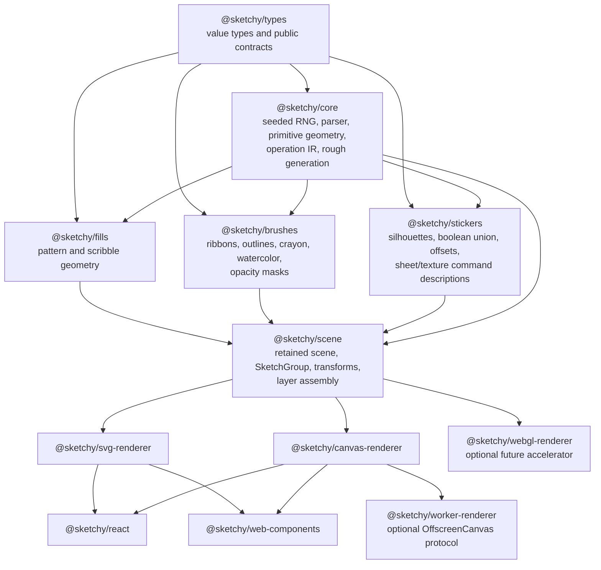

# SketchyJS implementation plan

> Companion docs: [plugin architecture](plugins.md) and [contributing plugins](contributing-plugins.md).

## Scope and baseline

This plan targets feature parity with Sketchy `v1.5.0` (`fb17a6e`), not literal SwiftUI API compatibility. The Swift package is a native Swift port of rough.js-style geometry: it generates seeded drawing operations, then SwiftUI/CoreGraphics paint those operations. SketchyJS should preserve the observable drawing semantics, use idiomatic TypeScript and web rendering APIs, and keep the computational core usable without a browser or DOM.

One important feature: Sketchy `v1.5.0` ships `StickerImage`, an image-masked sticker texture alongside the seeded procedural `StickerTexture.paper(...)` fibers. `StickerImage` wraps a caller-supplied, already decoded `UIImage` (Sketchy never fetches a URL) and masks it with the sticker sheet, so the image follows `.smooth`, `.fullySmooth()`, and `.torn()` edges, holes, and shared `SketchGroup` sheets. Placement is `.tile`, `.stretch`, or `.fill`, adjusted by `scale` and `opacity`. SketchyJS ports this as `StickerImage` on `StickerBacking.image` (see the table row and the `@sketchy/stickers` sketch below); acceptance fixtures come from the `v1.5.0` reference exporter.

Version delta from the original `v1.4.2` baseline of this plan: `v1.5.0` adds `StickerImage` and a `.smooth` sticker fix (a sheet keeps its square corner, and a hole smaller than the margin no longer collapses the offset into a round dilation, so a square backing with a small hole stays square). Sticker fixtures must be generated from `v1.5.0`, not `v1.4.2`.

### Goals

- Deterministic, seeded hand-drawn geometry with the same SplitMix64 sequence and documented option precedence as Sketchy.
- First-class SVG and Canvas 2D output; browser-independent core generation and testability.
- A small base import, with stickers, watercolor, brushes, and framework bindings separately importable.
- A rendered result that is visually comparable to seeded Sketchy reference artifacts while acknowledging platform font and rasterization differences.
- An API vocabulary intentionally recognizable to Sketchy users (`RoughView`, `SketchGroup`, `StickerBacking`, options such as `fillAngle`), expressed as retained-mode TypeScript drawing data rather than SwiftUI modifiers.

### Non-goals for the initial release

- Pixel-identical output across iOS CoreGraphics, every browser, every OS, and every font stack. Geometry/RNG parity is achievable; anti-aliasing, blur kernels, blend behavior, and font outlines vary by rendering engine.
- Making `@sketchy/stickers` independently generate rough shapes. “Import just stickers” means stickers plus the small shared geometry contract, not a standalone drawing generator with duplicated primitives.
- Starting with WebGL. SVG and Canvas 2D cover correctness and accessibility better; a GPU path follows only after profiling establishes it is necessary.

## 1. Feature inventory and web mapping

| Sketchy capability | Swift/iOS implementation today | SketchyJS equivalent and parity notes |
| --- | --- | --- |
| Geometry model and primitive shapes | `Drawable`, `Point`, `NativeGenerator`; rectangle, ellipse, circle, line, linear path, polygon, arc, Catmull-Rom curve, rounded rectangle, egg | Discriminated TypeScript `Shape` union and `Point`. Core emits serializable path operations (`move`, `line`, `quadratic`, `cubic`, `close`) plus semantic fill/stroke layers. Canvas uses `Path2D`; SVG serializes `d`. Auto-size SwiftUI helpers become optional binding/layout helpers, not core shapes. |
| Rough outline generation | Native Swift rough.js-style math; two rough passes, roughness, bowing, max randomness offset; continuous Bézier default and legacy sampled mode | Port the verified generator math into `@sketchy/core`. Keep `strokeContinuity: "continuous" | "legacy"`; continuous shapes retain cubic paths and legacy follows rough.js-like sampling. The core must be renderer-free. |
| SVG path parsing | `SVGPath`, `SVGArcConverter`, UIKit `UIBezierPath` for several path operations | Implement an SVG 1.1 path tokenizer/parser in core (all `M/L/H/V/C/S/Q/T/A/Z`, absolute/relative, repeated parameter groups). Convert arcs with SVG endpoint-to-center F.6.5/F.6.6 rules; negative radii become absolute, zero radius becomes a line, equal endpoints omit the arc, impossible radii scale up, and cubic segments span at most 90°. Never delegate parsing to a DOM API in core, since it is inconsistent across server runtimes and hard to test deterministically. |
| SVG fitting and SVG-specific stroke options | SwiftUI renderer fits a `Path(d:)` to available view size and supports SVG fill stroke alignment | Add explicit `fitPathToBox(path, box, preserveAspectRatio)` rather than hidden core state. Bindings offer `fit: "contain"` for the Sketchy-like convenience. SVG renderer maps `svgStrokeWidth`, `svgFillWeight`, and `svgFillStrokeAlignment` (`center`, `inside`, `outside`) to clip paths/masks; Canvas uses save/clip or compositing. Keep authored coordinates in a `SketchGroup`. |
| Text | CoreText produces glyph paths, UIKit font metrics place text | Do not make browser text-to-path a core requirement. Phase 1 supports supplied SVG paths (`TextPath`) and plain SVG/Canvas text as a non-parity convenience. Phase 2 exposes an adapter interface (`FontOutlineProvider`) backed by an OpenType parser such as `opentype.js` in a separate package. Consumers must provide/embed the font for deterministic text outlines. Browser `measureText` is adequate for layout but cannot guarantee glyph-path parity with iOS. |
| Fill styles | `FillPatternFactory` with hachure, solid, zigzag, cross-hatch, dots, sunburst/starburst, dashed, zigzag-line, scribble, watercolor | `@sketchy/fills` owns each deterministic fill generator and returns core operations. Preserve fill weight/spacing, fill spacing patterns, dash/zigzag offsets, padding, and fill offset. Hachure-family angles use screen coordinates: 0° horizontal and positive clockwise/downward. Dots intentionally ignore `fillAngle`; sunburst/starburst are radial. |
| Scribble fill | Native continuous zig-zag and conditional clipping for SVG/concave polygons | Implement in `@sketchy/fills`, clipping the generated single scribble centerline to arbitrary compound paths. Use a clip/mask in renderers rather than assuming ray casting prevents every concave leak. Support origin, tightness, tightness bands, curvature, and optional brush stroke treatment. |
| Fill padding/offset | CoreGraphics path/ellipse inset logic | Core geometry owns fill-region construction. Ellipses shrink/grow radii; polygons and paths use an offset algorithm. Define failure behavior: a collapsed inward offset yields no fill; self-intersection selects a documented fallback or omission. Apply offset after padding. |
| Brushes and variable width | `BrushTip`, `ThicknessProfile`, `VariableStrokeWidth`, `StrokeToFillConverter` | `@sketchy/brushes` samples centerlines adaptively, evaluates widths by normalized arclength, offsets the left/right ribbon, and returns fillable paths. Support circular/calligraphic/flat tips; uniform, taper, pressure, custom multiplier, seeded variable-width, and absolute width stops. Closed strokes intentionally normalize to uniform width to avoid seams. |
| Variable opacity | `OpacityProfile` rendered through one CoreGraphics luminance-to-alpha mask | The brushes package emits opacity segments/masks grouped by stroke. SVG renderer uses `<mask>` with non-accumulating coverage where possible; Canvas uses an offscreen mask canvas with `source-over` replacement semantics and tints it once. Avoid drawing translucent quads directly, because overlapping pieces darken incorrectly. Support uniform, samples, stops, and periodic seeded noise. |
| Crayon | `CrayonStroke` lays halo/core/grit/flake passes; hachure/zigzag/scribble may use it | `@sketchy/brushes/crayon` emits deterministic filled wax passes (not a platform-dependent filter). SVG paints path fills; Canvas paints equivalent `Path2D`s. Preserve seed precedence: explicit crayon seed wins, default crayon seed inherits `options.seed`. Thin fill lines still receive grit. |
| Watercolor stroke and fill | SwiftUI compositing of translucent glazes, irregular edges, rim, grain, blooms | `@sketchy/brushes/watercolor` creates reproducible layered fills/ribbons. Canvas handles it directly; SVG can emit grouped translucent paths plus clip paths. Preserve normal alpha stacking between separate washes/crossings, but not the non-darkening opacity-mask behavior used for opacity profiles. Support pigment, wetness, edge darkening, layers, variation, bleed, seed; no blur is required for parity. |
| Caps, joins, miter limit, curved bevel | CoreGraphics native outline for standard joins; custom ribbon geometry for variable width and curved bevel | Core owns cap/join/ribbon geometry, including butt/round/square caps, miter limit fallback, round/bevel, and `curvedBevel(bulge)`. Native SVG/Canvas stroke is acceptable only for standard uniform strokes; custom geometry is mandatory for `curvedBevel`, exact stroke-to-fill, variable width, crayon, watercolor, and predictable miter behavior. |
| Native stroke outline / stroke-to-fill | `CGPath.copy(strokingWithWidth:)` for standard joins, custom `StrokeToFillConverter` otherwise | Expose `strokeToOutline(centerlines, style)` as pure geometry. Do not rely on `Path2D`/Canvas `isPointInStroke` or browser-specific SVG `getTotalLength()` for generation. This is needed for clips, masks, sticker hulls, and renderer-independent tests. |
| Sticker backing | `StickerBackingBuilder` flattens/filters rough passes, uses silhouette guides, offsets rings, handles holes/ribbons/fallbacks | `@sketchy/stickers` consumes core drawing outlines and builds an independent sheet layer before ink. Preserve `width + strokeWidth/2`, smoothness from rough outline to input silhouette, holes, duplicate-pass removal, paper ribbon behavior for open strokes, miter-limited offsets, self-intersection protection, and a round-dilation fallback. A robust polygon-boolean/offset dependency may be justified here, isolated behind an adapter. |
| Sticker edges | Swift vectors: `.smooth`, `.fullySmooth(radius:)`, `.torn(StickerTear)` | Same TypeScript union: `"smooth"`, `{kind:"fullySmooth", radius?}`, `{kind:"torn", depth?, length?, jaggedness?}`. Smooth preserves real corners; fully smooth deliberately rounds all corners; torn mutates the offset contour using its own deterministic seed stream and validates it has not self-intersected. |
| Sticker color, paper texture, shadow | SwiftUI fills, clip paths, fiber paths, `GraphicsContext` shadow filter | Use CSS/SVG color values internally normalized to RGBA. Procedural paper fibers are deterministic, clipped to sheet (including holes), and drawn after sheet shadow. Shadow is a shadow of the sheet alpha—not ink, hatch gaps, or grain—and can be implemented with SVG filters or Canvas offscreen alpha blur. Keep sheet shadow optional and skip no-op shadows. |
| Image-masked texture (`StickerImage`, new in v1.5.0) | `StickerImage(image:placement:scale:opacity:)` on `StickerBacking.image`. `UIImage` is decoded by the caller (no URL fetch) and masked to the sheet path (even-odd, so holes stay empty). Placement `.tile` (default; `scale` is the repeat width in points, `0` = image's own point width, floored at 4, coarsened beyond about 900 repeats), `.stretch` (to the sheet bounding box) or `.fill` (aspect-fill, cropped by the mask); for stretch/fill `scale` multiplies the fitted size (`0` and `1` both mean fit; internal floor 0.05). `opacity` clamps to 0...1. Painted after the paper color and after `StickerShadow`, so it casts no shadow; paper color shows through transparent pixels and through `opacity` below 1; paper fibers draw on top. Follows smooth, fully smooth and torn edges, holes, and `SketchGroup` shared sheets. | `StickerImage` is `{ source, placement: "tile" \| "stretch" \| "fill", scale, opacity }` on `StickerBacking.image`, separate from `StickerBacking.texture` (paper fibers). `@sketchy/stickers` resolves placement to a pure, serializable `ImagePlacement` (tile origin/size/count, or a fitted rect) with the same clamps as Swift, so SVG and Canvas draw identical rectangles and the clamps are unit-testable without pixels. Layer order: `sheet-shadow`, `sheet` (paper color), `sticker-image`, `texture` (fibers), ink. SVG: `<clipPath>`/`<pattern>` + `<image>` clipped by the sheet path with `clip-rule="evenodd"`. Canvas: clip to the sheet path (even-odd) then `drawImage`, or offscreen draw + `destination-in` where the clip would alias. The image never affects the silhouette or any RNG stream. Image decode, loading, and cache ownership are renderer concerns (core sees an opaque `ImageSource` handle); loading and cross-origin taint failures are typed errors, never a silent drop. Not extensible by plugins (needs decoded pixels); see `docs/plugins.md`. |
| SketchGroup and SketchPart transforms | Swift result builder, `CGAffineTransform`; union before backing; transforms do not scale width/shadow | Use retained `SketchScene` / `SketchGroup` data, with `SketchPart` and explicit affine `Matrix2D`. Group backing is unioned in transformed point-space; part transforms happen before group transform. Preserve the important rule that nominal stroke/backing/shadow point widths do not scale with part geometry. SVG paths in groups retain authored coordinates and are not auto-fit. |
| Animation | SwiftUI precomputes path variance frames and drives a timer | `@sketchy/core` provides deterministic `PathVarianceGenerator` and `generateFrame(scene, config, index)`. `@sketchy/animate` provides browser scheduling (`requestAnimationFrame`) and precompute/cache policies. Canvas may repaint selected commands each frame; SVG updates `d` attributes or uses keyed frame layers. Keep seeded replay and `steps >= 2`; expose 600/300/100 ms presets and 0.5/1/5/10% variance. |
| Caching and performance instrumentation | Actor/main-thread caches and OS signposts | Core provides explicit bounded LRU cache interfaces keyed by geometry-affecting options and dimensions, never implicit global DOM state. Renderer bindings own cache lifetime. Browser adapters expose optional `PerformanceObserver`/User Timing marks; core has no browser dependency. |

## 2. Architecture

### Recommended relationship to rough.js

Use a **selective source-level port/reimplementation**, not a runtime dependency or a permanent fork:

1. Reuse rough.js concepts and validate compatible primitive/fill behavior where that is the intended compatibility target.
2. Port only the necessary algorithms into TypeScript under Sketchy's own tests and license notices: rough two-pass generation, hachure-family algorithms, curve math, and deterministic random use.
3. Keep Sketchy-specific capabilities—continuous Bézier outlines, `SketchGroup`, sticker union/offsetting, custom brushes, watercolor, non-darkening opacity masks, and seeded texture—owned by SketchyJS.

Depending on rough.js directly is attractive for basic shapes but creates incompatible option/RNG/caching semantics and cannot supply the custom stroke/sticker pipeline. A fork inherits upstream release and security maintenance, while deep patches would still make it a de facto private engine. Reimplementing every rough.js feature without using it as a behavioral reference is unnecessarily risky. The chosen strategy produces a small, auditable compatibility kernel with a differential test suite against rough.js for shared primitives.

### Layering



`@sketchy/types` must contain only values/contracts and no side effects. `@sketchy/core` must not import a renderer, browser global, image decoder, React, or a polygon clipping implementation. Expensive geometry (polygon booleans) belongs in `@sketchy/stickers`; a scene without stickers does not pay for it.

### Core IR and determinism

Use immutable, serializable data:

```ts
export type PathOp =
  | { op: "M"; x: number; y: number }
  | { op: "L"; x: number; y: number }
  | { op: "Q"; cx: number; cy: number; x: number; y: number }
  | { op: "C"; c1x: number; c1y: number; c2x: number; c2y: number; x: number; y: number }
  | { op: "Z" };

export interface DrawLayer {
  role: "sheet-shadow" | "sheet" | "sticker-image" | "texture" | "fill" | "fill-pattern" | "stroke" | "mask";
  paths: readonly PathOp[][];
  paint: Paint;
  clip?: ClipDescriptor;
  composite?: CompositeDescriptor;
}

export interface Drawing {
  readonly shape: ShapeKind;
  readonly outline: readonly PathOp[][];
  readonly layers: readonly DrawLayer[];
  readonly silhouette?: SilhouetteGuide;
}
```

The core should represent colors and paint semantics as values but not turn them into SVG strings or call `CanvasRenderingContext2D`. This makes Node test runs, worker rendering, serialization, and direct reference-fixture comparison possible.

Implement `SplitMix64` exactly using `bigint` state and 64-bit masking:

```ts
export class SplitMix64 {
  constructor(seed: bigint) {}
  nextU64(): bigint {}
  nextUnitFloat(): number {} // Specify the exact high-bit-to-[0,1] conversion.
}
```

Use a scoped `RngContext` passed through nested generation instead of a global mutable generator. A top-level seeded generate call creates one stream; nested fillers consume it. Independent style seeds (crayon, watercolor, opacity noise, paper texture, torn edge, animation) follow the documented default-seed inheritance rules and derive stable substreams without advancing the outline stream. Publish reference vectors, including Swift's known first four outputs for seed `42`, then add operation-level golden tests to prevent accidental RNG consumption reordering.

### Renderers

- **SVG renderer (required):** produce `<svg>` DOM elements or an SVG string from the IR. Use path fill rules, masks, clip paths, groups, filters for sheet shadow, and `vector-effect="non-scaling-stroke"` only where that actually matches the fixed-point-width transform contract. It is best for inspectability, accessibility hooks, export, and server-side SVG.
- **Canvas 2D renderer (required):** draw from IR to a provided `CanvasRenderingContext2D`. Use offscreen canvases for opacity masks, clipping, sheet-alpha shadows, texture/image masking, and watercolor layers. Make it work with DOM canvas and `OffscreenCanvas` via a minimal context adapter.
- **OffscreenCanvas worker path (optional after Canvas parity):** move pure generation and rasterization to a worker with transferable `ImageBitmap`/`OffscreenCanvas`; retain a protocol that supports cancellation and latest-frame-wins behavior. No worker dependency in core.
- **WebGL/WebGPU path (future and optional):** only accelerate tessellated fills/ribbons/large animated scenes. It must consume the same IR and pass the same geometry tests. Blurs, clipping, and image texture capabilities must be feature-gated; it must never be the only correct renderer.

## 3. Package split, APIs, and import behavior

Use a pnpm workspace monorepo:

```text
sketchyjs/
  packages/
    types/
    core/
    fills/
    brushes/
    stickers/
    scene/
    svg-renderer/
    canvas-renderer/
    animate/
    worker-renderer/
    webgl-renderer/       # later
    react/
    web-components/
  apps/
    playground/
    docs/
  fixtures/
    swift-reference/
    generated/
```

### Boundaries and public API sketches

#### `@sketchy/types`

Boundary: universally needed stable values with no runtime/browser dependencies. It prevents duplicate versions of `Point`, matrices, options, and IR contracts across renderer packages.

```ts
export interface Point { x: number; y: number }
export interface Size { width: number; height: number }
export type Color = string | readonly [r: number, g: number, b: number, a?: number];
export type Matrix2D = readonly [a: number, b: number, c: number, d: number, e: number, f: number];
export type FillStyle =
  | "hachure" | "solid" | "zigzag" | "crossHatch" | "dots"
  | "sunBurst" | "starBurst" | "dashed" | "zigzagLine" | "scribble" | "watercolor";
export interface SketchOptions { /* documented numeric/style options */ }
```

#### `@sketchy/core`

Boundary: deterministic primitive and SVG geometry. It does not know fill algorithms, brushes, stickers, HTML, or a renderer.

```ts
export { SplitMix64, parseSvgPath, arcToCubics, fitPathToBox };
export { line, rectangle, ellipse, circle, linearPath, polygon, arc, curve, roundedRectangle, egg };
export type Shape = /* discriminated shape union */;
export interface GenerateOptions extends SketchOptions { seed?: bigint | number }
export function generateOutline(shape: Shape, options?: GenerateOptions): DrawingOutline;
export function generateDrawing(shape: Shape, options?: GenerateOptions): CoreDrawing;
export function strokeToOutline(path: PathOp[], style: StrokeStyle): PathOp[][];
```

#### `@sketchy/fills`

Boundary: fill algorithms depend on core paths and options but not brushes or rendering. Keeping this separate means a stroke-only application does not import fill generators.

```ts
export function fill(shape: FillRegion, options: FillOptions, rng: Rng): FillLayer[];
export function hachure(region: FillRegion, options: HachureOptions, rng: Rng): PathOp[][];
export function scribble(region: FillRegion, options: ScribbleOptions, rng: Rng): PathOp[][];
export function insetFillRegion(region: FillRegion, padding: number, offset?: Point): FillRegion | null;
```

#### `@sketchy/brushes`

Boundary: all advanced outline-paint geometry. It depends on core/types, but not fills or stickers. This avoids pulling watercolor/crayon code into basic shape-only consumers.

```ts
export type BrushProfile = /* tip, width, cap/join, opacity, crayon, watercolor */;
export type ThicknessProfile = /* uniform/taper/pressure/custom/stops/variable */;
export function brushStroke(centerline: PathOp[], style: BrushStyle, rng: Rng): BrushLayer[];
export function nativeStrokeOutline(centerline: PathOp[], style: UniformStrokeStyle): PathOp[][];
export function crayonStroke(centerline: PathOp[], style: CrayonStyle, rng: Rng): BrushLayer[];
export function watercolorStroke(centerline: PathOp[], style: WatercolorStyle, rng: Rng): BrushLayer[];
```

#### `@sketchy/stickers`

Boundary: expensive silhouette/boolean/offset functionality, isolated so an application can import stickers without the renderer, or omit it entirely. It relies on core geometry contracts and optionally a carefully selected clipping backend behind an internal adapter.

```ts
export type StickerEdge = "smooth" | { kind: "fullySmooth"; radius?: number } |
  { kind: "torn"; depth?: number; length?: number; jaggedness?: number };
export type StickerTexture = { kind: "paper"; amount?: number; scale?: number; seed?: bigint };
export type StickerImagePlacement = "tile" | "stretch" | "fill";
/** Mirrors Sketchy v1.5.0 `StickerImage`. `source` is already decoded; nothing here fetches a URL. */
export interface StickerImage {
  source: ImageSource;                  // ImageBitmap | HTMLImageElement | OffscreenCanvas | data-URL descriptor
  placement?: StickerImagePlacement;    // default "tile"
  scale?: number;                       // tile: repeat width in px (0 = natural width, min 4); stretch/fill: multiplier (0 = 1)
  opacity?: number;                     // 0..1, default 1; clamped
}
export interface StickerBacking {
  width: number; smoothness?: number; edge?: StickerEdge; color?: Color;
  texture?: StickerTexture;             // procedural paper fibers, drawn on top of the image
  image?: StickerImage;                 // image masked by the sheet, drawn after the shadow and paper color
  shadow?: StickerShadow;
}
/** Pure geometry for the image layer: identical rectangles for every renderer. */
export function resolveImagePlacement(image: StickerImage, imageSize: Size, sheetBounds: Rect): ImagePlacement;
export function buildStickerBacking(parts: readonly StickerPartGeometry[], backing: StickerBacking, seed?: bigint): StickerLayers;
export function unionSilhouettes(parts: readonly Silhouette[]): Silhouette;
```

#### `@sketchy/scene`

Boundary: the ergonomic retained-mode assembly API, including `SketchGroup`, applies core/fills/brushes/stickers in the right paint order. This package is the recommended default API for renderer users.

```ts
export class RoughView {
  with(options: Partial<SketchOptions>): RoughView;
  draw(shape: Shape): RoughView;
  build(bounds: Size): Scene;
}
export class SketchPart {
  static of(view: RoughView): SketchPart;
  offset(x?: number, y?: number): SketchPart;
  scale(value: number, anchor?: Point): SketchPart;
  rotate(radians: number, anchor?: Point): SketchPart;
  transform(matrix: Matrix2D): SketchPart;
}
export class SketchGroup {
  constructor(parts: readonly (RoughView | SketchPart)[]);
  withBacking(backing?: StickerBacking): SketchGroup;
  transform(matrix: Matrix2D): SketchGroup;
  build(bounds: Size): Scene;
}
```

#### `@sketchy/svg-renderer` and `@sketchy/canvas-renderer`

Boundary: terminal rendering only. They share the scene/type contracts but do not import React or web components.

```ts
// @sketchy/svg-renderer
export function renderToSvgString(scene: Scene, options?: SvgRenderOptions): string;
export function renderToSvgElement(scene: Scene, document: Document, options?: SvgRenderOptions): SVGSVGElement;

// @sketchy/canvas-renderer
export function renderToCanvas(scene: Scene, context: CanvasRenderingContext2D | OffscreenCanvasRenderingContext2D, options?: CanvasRenderOptions): void;
export function createCanvasRenderer(options?: CanvasRendererOptions): CanvasRenderer;
```

#### `@sketchy/animate`, `@sketchy/react`, and `@sketchy/web-components`

Boundary: optional convenience integrations. Animation scheduling should not force React or DOM onto core users.

```ts
// @sketchy/animate
export function createAnimation(scene: Scene, config: AnimationConfig): AnimationController;
export function generateFrame(scene: Scene, config: AnimationConfig, frame: number): Scene;

// @sketchy/react
export function SketchyCanvas(props: SketchyCanvasProps): React.ReactElement;
export function SketchySvg(props: SketchySvgProps): React.ReactElement;
export function useSketchAnimation(scene: Scene, config: AnimationConfig): Scene;

// @sketchy/web-components
export function defineSketchyElement(tagName?: string): void;
```

### Tree shaking, exports, and build format

Publish ESM-first packages. Use ESM-only for v1 (`"type": "module"`) because modern bundlers and web targets are the primary audience; provide a browser IIFE bundle only as an explicitly requested CDN artifact, not as a second package entry. Do not ship CommonJS by default: dual-package hazards make TypeScript types, singleton caches, and plugin instances harder to reason about. Reconsider CJS only if measured downstream demand justifies a separate compatibility build.

Every package should use `"sideEffects": false`, with narrow exceptions: the web-components package must list its custom-element registration entry as a side effect if it auto-registers. Prefer an explicit `defineSketchyElement()` call, so it can remain side-effect-free. No package root should import every optional renderer.

Example `@sketchy/stickers/package.json`:

```json
{
  "name": "@sketchy/stickers",
  "type": "module",
  "sideEffects": false,
  "exports": {
    ".": { "types": "./dist/index.d.ts", "import": "./dist/index.js" },
    "./paper": { "types": "./dist/paper.d.ts", "import": "./dist/paper.js" },
    "./image": { "types": "./dist/image.d.ts", "import": "./dist/image.js" }
  }
}
```

`@sketchy/scene` should expose subpaths such as `@sketchy/scene/basic` and `@sketchy/scene/stickers`; the latter imports `@sketchy/stickers`, while basic scenes do not. Users can therefore write:

```ts
import { SketchGroup, StickerBacking } from "@sketchy/scene/stickers";
import { renderToSvgString } from "@sketchy/svg-renderer";
```

and receive core + fills/brushes only if used + stickers + SVG renderer, not Canvas, React, Web Components, worker code, or WebGL. Document that all renderer packages are peers chosen by the application, not automatic fallbacks.

### Rough bundle-size targets (gzip; estimates, not promises)

| Import surface | Target gzip size | Notes |
| --- | ---: | --- |
| `@sketchy/types` | < 2 KB | Mostly declarations/helpers |
| `@sketchy/core` basic primitives + parser | 12–18 KB | Includes SVG arc parser/converter |
| `@sketchy/fills` | 7–12 KB | Excludes watercolor brush implementation |
| `@sketchy/brushes` | 12–20 KB | Crayon/watercolor can be subpath imports |
| `@sketchy/stickers` procedural paper | 10–18 KB plus clipping backend | Polygon boolean implementation is the uncertainty |
| SVG renderer | 5–9 KB | Excludes DOM framework binding |
| Canvas renderer | 6–12 KB | Excludes worker wrapper |
| Basic SVG scene (`scene/basic` + core/fills + SVG) | 28–42 KB | Typical app entry |
| Sticker SVG scene | 42–65 KB plus clipping backend | Depends on boolean/offset choice |
| React binding incremental cost | 2–5 KB | React itself is a peer dependency |

Enforce these through a size-limit CI job with warning and hard ceilings after the first measured release. The stated values are estimates because the chosen robust polygon boolean backend materially affects sticker size.

## 4. Tooling, testing, docs, CI, and releases

### Toolchain

- **Language:** TypeScript with `strict`, `noUncheckedIndexedAccess`, `exactOptionalPropertyTypes`, ESM module resolution, and declaration output.
- **Monorepo:** pnpm workspaces plus Turborepo for dependency-aware task orchestration and remote/local caching. pnpm makes package boundaries and lockfile behavior explicit.
- **Build:** `tsup`/esbuild for fast per-package ESM + `.d.ts` builds; use Rollup only if an SVG/IIFE bundle requires output-level control. Keep source unbundled for packages and use a separate bundle job for size tests.
- **Formatting/linting:** Prettier, ESLint with type-aware rules, and `typescript-eslint`; avoid a build-time formatter that rewrites generated fixture data.
- **Unit tests:** Vitest for pure core/geometry packages. Browser renderer integration tests run in Playwright Chromium, Firefox, and WebKit.
- **Visual tests:** Playwright screenshots for SVG and Canvas on a pinned browser version, plus pixelmatch/SSIM thresholds and an HTML review report. Do not compare antialiased Swift PNGs directly at zero tolerance.
- **Docs/playground:** VitePress (or Astro Starlight if richer interactive examples are needed) with live SVG/Canvas toggle, downloadable SVG, serialized-scene inspector, and generated API reference from TypeDoc.

### Parity test design

1. **Operation-level fixtures:** export deterministic Swift reference fixtures for shapes/options as JSON: shape input, resolved options, SplitMix64 values, path operations, fill operations, and sticker contour points. Generate these in a dedicated, versioned fixture exporter rather than scraping screenshots.
2. **Independent mathematical assertions:** port current Swift test cases for RNG, SVG arcs, width/opacity stops, joins/miter fallback, sticker holes/torn edges/fully smooth outlines, group union, animation seed behavior, and adaptive Bézier sampling. Tests must not call a second implementation to calculate the expected result.
3. **Cross-language comparison:** compare normalized numeric arrays with explicit tolerances only where Float/Double differences are unavoidable. Exact compare is required for seeded RNG output and integer-like topology (operation type/order, holes, number of arc cubics).
4. **Visual comparison:** create a canonical fixture gallery at fixed CSS pixels and device scale. Compare SketchyJS SVG against SketchyJS Canvas closely; compare both to Swift references using masks/thresholds and per-feature acceptance bounds. Store reviewed reference images under `fixtures/swift-reference/v1.5.0/`.
5. **Font fixtures:** do not use system fonts. Check in a license-compatible test font and its expected SVG outline fixture, then test browser adapters separately for fallback behavior.
6. **Fuzz/property tests:** parser fuzzing for SVG commands, finite-number/no-throw invariants, polygon offset/union validity, no self-intersection after torn backing fallback, and deterministic replay for all seeded effects.

### CI flow

On every pull request:

1. install with frozen lockfile;
2. lint, format check, TypeScript project-reference build;
3. run pure unit/property tests;
4. build every package and validate `exports` with a clean consumer fixture;
5. run Playwright renderer, visual, SVG validity, and accessibility smoke tests;
6. run bundle-size budget and dependency/license audit;
7. upload visual diff report as an artifact.

On merge to `main`/`master`, rerun the same immutable build, publish preview artifacts only if configured, and generate docs preview. Use Changesets for version intent and release notes. The release workflow must:

1. verify a clean checkout and complete CI;
2. consume changesets and publish packages with npm provenance;
3. create one annotated, **v-prefixed** repository tag such as `v1.0.0`;
4. publish the docs version and GitHub release notes from the same commit;
5. verify package tarballs in a fresh consumer install.

Do not tag feature branches or use tags as build identifiers.

## 5. Phased roadmap

### Phase 0 — contracts and reference corpus

- Establish the workspace, package boundaries, lint/type/test rules, generated API documentation, and consumer fixture.
- Define JSON schemas for options, path operations, scenes, geometry snapshots, colors, and deterministic seeds. Specify all clamping/default rules in one source of truth.
- Add a small Swift fixture exporter pinned to v1.5.0 and commit generated reference data/images with manifest hashes.
- Decide and benchmark the polygon clipper/offset backend using concave, compound-hole, and dense-group sticker fixtures before any public sticker API.

Exit criterion: `SplitMix64(seed: 42)` matches the documented Swift sequence, generated fixture manifests are reproducible, and package export smoke tests pass.

### Phase 1 — MVP: core shapes, basic fills, SVG

- Implement core shape values, continuous and legacy outlines, seeds, roughness/bowing/randomness, and SVG parser including arcs.
- Implement solid, hachure, cross-hatch, dots, dashed, zigzag, zigzag-line, and sunburst/starburst fills with fill angle, spacing, padding, offset, and SVG fit semantics.
- Implement scene assembly and SVG string/DOM renderer for normal fill/stroke/clipping.
- Provide a compact builder API and a direct functional API; document naming parity and intentional differences.

Exit criterion: all primitive/SVG arc operation fixtures pass; SVG output demonstrates the README/Examples primitives and fills; basic import stays inside the agreed size target.

### Phase 2 — Canvas, advanced strokes, and animation

- Add Canvas 2D renderer using the same scene IR, including clips and standard uniform strokes.
- Implement adaptive Bézier centerline sampling, stroke-to-fill, tips, thickness profiles, width stops, caps, miter limits, and curved bevel.
- Add variable opacity masks, crayon passes, watercolor strokes/fills, and corresponding Canvas/SVG compositing paths.
- Add deterministic animation frame generation and an optional browser animation controller; precompute/cancel frames safely on resize.

Exit criterion: SVG and Canvas geometry tests share the same scene fixtures, visual deltas are within agreed limits, and all brush/animation seed fixtures replay.

### Phase 3 — stickers and groups

- Implement sticker single-shape contours, smoothness guides, holes, open ribbon backing, smooth/fully-smooth/torn edges, procedural paper fibers, and sheet shadows.
- Implement `SketchGroup`/`SketchPart` affine transforms and vector silhouette union. Verify disconnected components, shared corners, nested holes, child backing suppression, fixed stroke/backing/shadow widths under transforms, and SVG coordinate behavior.
- Implement `StickerImage` (`@sketchy/stickers/image`): `tile`/`stretch`/`fill` placement with `scale` and `opacity`, pure `resolveImagePlacement` with Swift's clamps (4 px tile floor, about 900-repeat cap, 0.05 fit floor), masking by the sheet path (including holes and torn edges), painted after the shadow and paper color with fibers on top. Source loading remains the caller's responsibility, as in Swift, with typed errors for decode/taint failures.

Exit criterion: all v1.5.0 sticker/group reference fixtures pass geometrically (including the `.smooth` square-corner-with-small-hole case); `resolveImagePlacement` matches Swift for tile, stretch, and fill; visual tests cover paper, torn edge, shadow, holes, shared backing, and image masking (no image shadow, paper color through transparent pixels, fibers on top).

### Phase 4 — bindings, documentation, and release hardening

- Add React components/hooks and optionally the explicit web-component registration package.
- Publish interactive docs gallery, migration guide, rendering/backend capability matrix, accessibility guidance, and performance/caching guide.
- Add OffscreenCanvas worker renderer only after documented benchmarks prove its benefit; prototype WebGL/WebGPU only against high-density performance cases.
- Complete release automation, size budgets, visual review policy, compatibility matrix, and v-prefixed stable release.

Exit criterion: a fresh external app can use SVG or Canvas, use stickers without React, use React without Canvas, and reproduce documented seeded examples.

## Risks, decisions to make, and mitigations

| Risk / open question | Why it matters | Proposed resolution |
| --- | --- | --- |
| Exact rough.js equivalence versus Sketchy’s newer continuous geometry | rough.js itself does not match all of v1.5.0 | Make Sketchy v1.5.0 fixtures authoritative. Add rough.js differential tests only for features Sketchy intentionally inherits. |
| Polygon union/offset robustness and bundle cost | Stickers depend on compound paths, holes, concavity, and collision fallback | Benchmark two maintained JS/WASM clipper choices in Phase 0. Hide either behind a small adapter; avoid handwritten general polygon boolean code. |
| Browser text parity | iOS CoreText and browser shaping/outlines differ | Require a supplied font outline provider for parity. Keep DOM text a convenience fallback and document it as non-identical. |
| CSS/SVG/Canvas raster differences | blur, alpha, filter bounds, anti-aliasing differ | Test geometry separately from pixels; maintain renderer-specific visual baselines and tolerances. |
| Image texture security and loading | cross-origin images can taint Canvas and block export; Swift's `StickerImage` takes an already decoded image and never fetches | Match Swift: `StickerImage.source` is caller-decoded (`ImageBitmap`/`CanvasImageSource` for Canvas; inline/data URL or same-origin for SVG export). Provide an optional helper outside core that decodes a `Blob`/URL into an `ImageBitmap`. Return typed loading/taint errors; never silently drop an image. |
| API shape | Copying Swift modifier chains literally can be awkward and mutable in JS | Offer immutable fluent `RoughView` parity names and a data-first function API. Do not pretend a SwiftUI `.frame()` exists; use explicit `build({width,height})`/renderer dimensions. |
| Performance for animation/large groups | repeated tessellation, boolean geometry, and texture passes can be expensive | Cache pure geometry by stable option hashes; precompute frames lazily; cap texture budgets; profile before adding GPU work. |
| Numeric semantics | Swift `Float` versus JS `number` and `bigint` can shift operations | Centralize conversion and rounding rules; reference test every seeded operation stream; never use `Math.random()` in seeded paths. |

## API naming and migration strategy

Use Sketchy names where their semantics transfer directly: `RoughView`, `RoughTextPath`, `SketchGroup`, `SketchPart`, `StickerBacking`, `StickerShadow`, `FillStyle`, `BrushProfile`, `AnimationConfig`, `fillAngle`, `fillPadding`, `strokeContinuity`, `widthStops`, and `opacityProfile`. Preserve Swift option defaults and unit meanings in CSS pixels (the natural web equivalent of points at a 1x logical coordinate system).

Change names where platform behavior differs rather than creating a misleading imitation:

- SwiftUI modifiers such as `.frame`, `.offset`, and `.scaleEffect` become renderer/layout concerns. Sketchy-specific transforms remain `part.offset`, `part.scale`, `part.rotate`, and `group.transform`.
- `Color`/`UIColor` overloads become a single `ColorLike` input accepted by renderers; normalize immediately.
- `Path(d:)` becomes `svgPath(d)` to avoid colliding with browser globals and framework path types.
- `RoughText` takes a text outline/provider or is clearly labeled non-parity when using browser text.
- `.animated()` becomes `createAnimation(scene, config)` or framework-specific declarative props, with `generateFrame` available for deterministic rendering/export.

Ship an API parity table in the docs, marking each item as **same semantics**, **web-adapted**, **experimental**, or **not applicable**. Ship `StickerImage` under the `@sketchy/stickers/image` subpath (so apps without image stickers do not pay for it), marked **web-adapted**: the placement/scale/opacity semantics are the same as Sketchy `v1.5.0`, while the image input is a web `ImageSource` instead of `UIImage`.

## Maintainability review

The proposed boundaries follow execution and cost boundaries, not arbitrary feature labels: core remains deterministic and browser-free; fills, advanced brushes, stickers, and terminal renderers compose through a serializable IR. This keeps unit tests fast, makes SVG/Canvas parity testable, and prevents a common failure mode where renderer quirks leak into geometry. `SketchGroup` and stickers are intentionally isolated because their boolean/offset requirements are algorithmically heavier and should not inflate a basic hand-drawn line import.

The main long-term risk is visual drift caused by implementing the same semantics twice in SVG and Canvas. The mitigation is to make geometry and compositing intent data, then test both renderers from the same fixtures rather than sharing renderer code. Before implementation begins, the two decisions that most affect complexity are the polygon clipping backend and the required text-parity tier; resolving them with Phase 0 benchmarks and fixtures will prevent an unstable public API.
