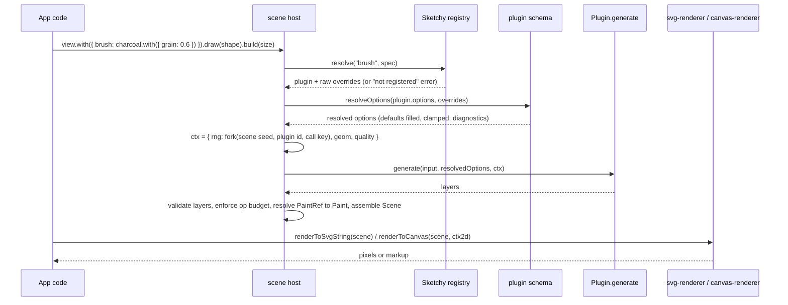

# SketchyJS plugin architecture

> **Status: the contract, the builders, fill hosting, and the crayon brush are implemented.** What exists today is listed in [Implementation status](#implementation-status). Texture and edge hosting, the ESLint preset, `@sketchy-js/testkit`, and the compat layer are still the target design and are marked *planned* where it matters. The published plugin API is **1.0**. The fields that an earlier draft called API 1.1 (`FillRegion.shape`, `GeometryKit.rough`, `FillBase.strokeWidth`, `PluginMeta.paints`, and `FillBase.pattern`) are part of 1.0; nothing has been published, so the version was not bumped. `BrushInput.seed` is also part of 1.0.

SketchyJS has four extension points: **brushes**, **fills**, **textures**, and **sticker edges**. Each is a plugin: a plain, frozen object holding metadata, an option schema, and one pure function. Everything the library ships in those categories (crayon, watercolor, hachure, paper grain, torn edges, ...) is implemented through the same public contract. A contributor adds a look by writing one file, and it renders in SVG and Canvas without touching a renderer.

Related docs: [implementation plan](plan.md), [contributing plugins](contributing-plugins.md), [CONTRIBUTING](../CONTRIBUTING.md).

## Implementation status

Verified against the code on this branch (`packages/plugin`, `packages/fills`, `packages/scene`).

| Area | State |
| --- | --- |
| Contract types for all four kinds, option schema builders (`s`), `PLUGIN_API_VERSION = { major: 1, minor: 0 }` | Implemented (`@sketchy-js/plugin`). This is the version that will be published |
| `defineBrush`, `defineFill`, `defineTexture`, `defineStickerEdge` (brand, deep freeze, `with()`, development-only shape and default validation) | Implemented |
| `@sketchy-js/plugin/schema`: `resolveOptions`, `validateSchema`, `validateDefinition`, `toJsonSchema`, `hashOptions`, `checkPluginApi`/`assertPluginApi`, `PluginOptionError`, `PluginApiError` | Implemented. The registry calls `assertPluginApi` at `use()` and when a plugin object is resolved, so a major mismatch or a newer minor is rejected |
| Conformance helpers in `@sketchy-js/plugin`: `withRandomGuard`, `assertDeterministic`, `assertInputImmutable`, `assertInterleavingStable`, `assertWithinBudget`, `countOps` | Implemented; see [section 3](#3-the-purity-contract-and-how-it-is-enforced) for exactly what each checks |
| `createSketchy()` registry (immutable `use`, `replace`, `alias`, `has`, `list`, `resolve`, `view()`), `PluginRegistrationError`, `PluginNotRegisteredError` | Implemented for all kinds as data, in `@sketchy-js/scene` |
| Fill hosting: `ctx.rng` (shared or forked), `ctx.geom` including `ctx.geom.rough`, `ctx.warn` to scene diagnostics, part conversion, non-finite and op-budget handling | Implemented (`scene/src/fill-stage.ts`). Nine built-in fills ship in `@sketchy-js/fills` as `defineFill` plugins |
| Brush hosting for `crayon` | Implemented. The scene calls a registered `crayon` brush and replaces stroke layers with its wax passes. Texture and edge hosting, and `PluginBudgetError`, are still planned |
| `@sketchy-js/testkit` (`describePlugin`, `runX` helpers, `defineDemo`), `pnpm new`, `pnpm docs:plugins`, ESLint preset `plugin`, `@sketchy-js/contrib`, `@sketchy-js/scene/compat` | Planned |

## Contents

1. [Goals and non-goals](#1-goals-and-non-goals)
2. [Plugin kinds and where they run](#2-plugin-kinds-and-where-they-run)
3. [The purity contract and how it is enforced](#3-the-purity-contract-and-how-it-is-enforced)
4. [Contracts (TypeScript)](#4-contracts-typescript)
5. [Option schema](#5-option-schema)
6. [Registration, resolution, and tree-shaking](#6-registration-resolution-and-tree-shaking)
7. [API versioning and compatibility](#7-api-versioning-and-compatibility)
8. [Dogfooding: built-ins are plugins](#8-dogfooding-built-ins-are-plugins)
9. [Worked example: a charcoal brush](#9-worked-example-a-charcoal-brush)
10. [Risks and open questions](#10-risks-and-open-questions)

## 1. Goals and non-goals

Goals:

- **Low barrier.** A new brush is one module (about 100 lines for a good one), one test file, one demo file, and one docs file, all scaffolded by `pnpm new`.
- **Renderer independence.** A plugin maps geometry, options, and a seeded RNG to path operations and layers. It never sees `document`, `CanvasRenderingContext2D`, `Path2D`, or an SVG element. SVG and Canvas output follow from the existing IR ([plan: Core IR](plan.md#core-ir-and-determinism)).
- **Determinism.** The same `(input, options, seed)` always yields the same output, so scenes, animation frames, caches, and snapshot tests are reproducible.
- **One schema, many consumers.** Validation, generated docs, playground controls, gallery thumbnails, React prop types, and cache keys all derive from the option schema.
- **No global side effects.** Importing a plugin registers nothing. Using one means passing it to the library explicitly. Bundlers can drop everything you do not use.
- **Stable contract.** A plugin written against API `1.x` keeps working for every `1.y` host with `y >= x`.

Non-goals:

- **Raster or pixel-reading plugins.** Plugins emit vector paths only. `StickerImage` (Sketchy v1.5.0 image-masked textures) is deliberately *not* a plugin; see [section 8.4](#84-why-stickerimage-is-not-a-plugin).
- **Plugins that call other plugins.** Composition happens in the host through data flow (a fill returns centerlines; the host strokes them with the active brush). This keeps the dependency graph flat and conformance testing local.
- **Replacing core geometry.** Rough outline generation, SVG parsing, stroke-to-fill, polygon union, and sticker offsetting stay in core packages. Plugins sit on top of them.
- **Sandboxing untrusted code.** The contract keeps *well-behaved* plugins portable and testable. It is not a security boundary; do not execute plugin code you do not trust. Worker isolation is a possible later addition ([section 10](#10-risks-and-open-questions)).

## 2. Plugin kinds and where they run

| Kind | Define with | Receives | Returns | Pipeline slot | Built-in examples |
| --- | --- | --- | --- | --- | --- |
| `brush` | `defineBrush` | A centerline path, stroke style, bounds | `BrushLayer[]` (filled shapes painted in the stroke color) | Replaces native stroke painting for each rough pass | `crayon`, `watercolor`, `marker` |
| `fill` | `defineFill` | A fill region (outer ring and holes, fill rule, bounds) and fill style | `FillPart[]`: filled areas and/or centerlines the host strokes | Produces the interior of a shape | `solid`, `hachure`, `crossHatch`, `dots`, `scribble`, `watercolor` |
| `texture` | `defineTexture` | The sticker sheet geometry and paper color | `TextureLayer[]` (vector marks, always clipped to the sheet by the host) | After the sheet and any `StickerImage`, before ink | `paper` (fibers) |
| `edge` | `defineStickerEdge` | Offset sticker contour rings with corner flags | Replacement rings | After offsetting, before the sheet is painted | `smooth`, `fullySmooth`, `torn` |

Paint order for a sticker (matches Sketchy v1.5.0, where the image is painted after the shadow, so it casts none, and fibers draw on top):


Request routing, from the user's call to pixels. Renderers only ever receive the already-built scene, so they need no plugin code and a serialized scene renders anywhere.



## 3. The purity contract and how it is enforced

A plugin is a pure function of `(input, resolvedOptions, ctx)`:

1. **Inputs only.** It reads nothing but its arguments and compile-time constants. No module-level mutable state, no caches, no reading the clock.
2. **Randomness only from `ctx.rng`.** `Math.random`, `Date.now`, `performance.now`, `crypto.getRandomValues`, and `new Date()` are forbidden. Every draw must come from the injected seeded RNG.
3. **No platform access.** No DOM, Canvas, `Path2D`, `OffscreenCanvas`, `fetch`, `window`, `document`, `globalThis` reads, or Node built-ins.
4. **No input mutation, no output aliasing.** Inputs are deep-frozen by the conformance helper `assertInputImmutable`. Returned arrays are fresh. (The host does not freeze inputs at runtime today.)
5. **No cross-plugin calls and no host internals.** The only runtime import allowed in a plugin module is `@sketchy-js/plugin`. Geometry helpers arrive through `ctx.geom`.
6. **Total functions.** Degenerate geometry (empty path, zero length, collapsed region) returns valid output, possibly `[]`. It never throws and never returns `NaN` or `Infinity`.
7. **Bounded work.** Output size must stay within `ctx.maxOps` (default 200,000 operations per fill). The fill host does not throw: it drops the offending part and reports a `fill-max-ops` diagnostic (`PluginBudgetError` is planned). Non-finite numbers are likewise dropped with `fill-non-finite`.

JavaScript cannot prove purity, so enforcement is layered. The *State* column says what exists today.

| Layer | What it catches | State |
| --- | --- | --- |
| Type surface | Plugin packages compile with `lib: ["ES2022"]` and `types: []`, so DOM and Node globals do not type-check | Convention; the built-in fills package does this under `tsc` |
| ESLint preset `plugin` from `@sketchy-js/eslint-plugin` (dev-only): banned identifiers, banned imports (anything but `@sketchy-js/plugin` and relative files), top-level mutable state, missing `/*#__PURE__*/` | Planned. The repository ESLint config bans `Math.random` in source, but there is no plugin preset |
| Hermetic runtime | `withRandomGuard` replaces `Math.random`, `Date.now`, `performance.now`, `crypto.getRandomValues`, and `crypto.randomUUID` with throwing functions while a callback runs; `assertInputImmutable` runs `generate` on a deep-frozen copy and rejects output that aliases input objects | Implemented for those globals. **Not covered:** `new Date()` with no arguments, DOM and Canvas globals (`document`, `window`, `Path2D`, `OffscreenCanvas`), `fetch`, and the module import graph |
| Differential runs | `assertDeterministic` (same call twice gives identical JSON) and `assertInterleavingStable` (A, B, A gives the same A twice) | Implemented as helpers. Planned: fresh-module re-import, call-counting RNG, seed sensitivity, option-order independence, dead-option detection |
| Output validation | `assertWithinBudget` (operation count against `maxOps`, finite numbers) as a helper; the fill host drops non-finite and over-budget parts with diagnostics | Implemented for fills. Full validation of layers, roles, and malformed paths is planned with brush, texture, and edge hosting |

What each conformance check does and which are planned is in [contributing-plugins.md](contributing-plugins.md#3-the-conformance-suite).

## 4. Contracts (TypeScript)

Where the code lives. These are additions to the package list in the plan:

| Package | Role | Runtime cost for plugin authors |
| --- | --- | --- |
| `@sketchy-js/plugin` (tiny, depends only on `@sketchy-js/types`) | Contract types, `defineBrush`/`defineFill`/`defineTexture`/`defineStickerEdge`, the `s` schema builders, `PLUGIN_API_VERSION`, the conformance helpers | About 1 KB gzip; the only import a plugin needs |
| `@sketchy-js/plugin/schema` | `resolveOptions`, `validateSchema`, `toJsonSchema`, `hashOptions`. Used by the host and tools, never bundled into a plugin | None |
| `@sketchy-js/scene` | The host: `createSketchy()` registry and the fill stage. The `GeometryKit` and `RoughKit` implementations live in `@sketchy-js/core` (`createGeometryKit`, `createRoughKit`) and `Rng` is `core`'s `Rng` | None (peer of the app) |
| `@sketchy-js/testkit` (**planned**, not in the repository) | `describePlugin` conformance suite, fixtures, `runBrush`/`runFill`/`runTexture`/`runEdge` helpers, `defineDemo` | dev dependency |
| `packages/contrib` (**planned**, published as `@sketchy-js/contrib`) | Community plugins with per-plugin subpath exports | per plugin |

### 4.1 Shared value types

Re-exported from `@sketchy-js/types`; shown here because every contract builds on them.

```ts
export interface Point { x: number; y: number }
export interface Rect { x: number; y: number; width: number; height: number }
export type Color = string | readonly [r: number, g: number, b: number, a?: number];
export type PathOp =
  | { op: "M"; x: number; y: number }
  | { op: "L"; x: number; y: number }
  | { op: "Q"; cx: number; cy: number; x: number; y: number }
  | { op: "C"; c1x: number; c1y: number; c2x: number; c2y: number; x: number; y: number }
  | { op: "Z" };
export type Path = readonly PathOp[];
```

### 4.2 Versioning constants

```ts
export const PLUGIN_API_VERSION = { major: 1, minor: 0 } as const;
export type PluginApi = `${number}.${number}`;
export type PluginKind = "brush" | "fill" | "texture" | "edge";
```

### 4.3 Option schema types

```ts
export type Unit = "px" | "deg" | "ratio" | "ms" | "count" | "none";
interface SpecBase {
  readonly label?: string;
  readonly description: string;
  readonly group?: string;
  readonly advanced?: boolean;
}
export interface NumberSpec extends SpecBase {
  readonly type: "number";
  readonly default: number;
  readonly min: number;
  readonly max: number;
  readonly step?: number;
  readonly unit?: Unit;
  readonly scale?: "linear" | "log";
  readonly uiMin?: number;
  readonly uiMax?: number;
}
export interface IntSpec extends SpecBase {
  readonly type: "int";
  readonly default: number;
  readonly min: number;
  readonly max: number;
  readonly unit?: Unit;
}
export interface BooleanSpec extends SpecBase { readonly type: "boolean"; readonly default: boolean }
export interface ChoiceSpec<V extends string = string> extends SpecBase {
  readonly type: "choice";
  readonly values: readonly V[];
  readonly default: V;
}
export interface ColorSpec extends SpecBase { readonly type: "color"; readonly default: string | "inherit" }
export interface RangeSpec extends SpecBase {
  readonly type: "range";
  readonly default: readonly [number, number];
  readonly min: number;
  readonly max: number;
  readonly step?: number;
  readonly unit?: Unit;
}
export type OptionSpec = NumberSpec | IntSpec | BooleanSpec | ChoiceSpec | ColorSpec | RangeSpec;
export type OptionSchema = { readonly [key: string]: OptionSpec };

export type SpecValue<T extends OptionSpec> =
  T extends NumberSpec | IntSpec ? number
  : T extends BooleanSpec ? boolean
  : T extends ChoiceSpec<infer V> ? V
  : T extends ColorSpec ? string
  : T extends RangeSpec ? readonly [number, number]
  : never;
export type Resolved<S extends OptionSchema> = { readonly [K in keyof S]: SpecValue<S[K]> };
export type Overrides<S extends OptionSchema> = { readonly [K in keyof S]?: SpecValue<S[K]> };

export const s = {
  number: (o: Omit<NumberSpec, "type">): NumberSpec => ({ type: "number", ...o }),
  int: (o: Omit<IntSpec, "type">): IntSpec => ({ type: "int", ...o }),
  boolean: (o: Omit<BooleanSpec, "type">): BooleanSpec => ({ type: "boolean", ...o }),
  color: (o: Omit<ColorSpec, "type">): ColorSpec => ({ type: "color", ...o }),
  range: (o: Omit<RangeSpec, "type">): RangeSpec => ({ type: "range", ...o }),
  choice: <const V extends string>(o: Omit<ChoiceSpec<V>, "type">): ChoiceSpec<V> => ({ type: "choice", ...o }),
} as const;
```

### 4.4 Services the host hands to a plugin

```ts
export interface Rng {
  next(): number;
  range(min: number, max: number): number;
  int(minInclusive: number, maxExclusive: number): number;
  normal(mean?: number, sd?: number): number;
  chance(p: number): boolean;
  pick<T>(items: readonly [T, ...T[]]): T;
  /** Pure: the same label on the same parent always returns the same stream. Parent draws are not consumed. */
  fork(label: string): Rng;
}
export interface FlatSubpath { readonly points: readonly Point[]; readonly closed: boolean; readonly length: number }
export interface Sample { readonly point: Point; readonly tangent: Point; readonly normal: Point; readonly s: number }
export interface Segment { readonly a: Point; readonly b: Point }
/** Analytic description of an elliptical region. */
export type FillShape =
  | { readonly kind: "ellipse"; readonly cx: number; readonly cy: number; readonly rx: number; readonly ry: number }
  | { readonly kind: "arc"; readonly cx: number; readonly cy: number; readonly rx: number; readonly ry: number;
      readonly start: number; readonly stop: number }
  | { readonly kind: "path" };

/**
 * Seeded rough-drawing helpers bound to the current shape's options and shared outline stream.
 * They reproduce Sketchy's `RoughMath` draw order so Swift-parity fills can match
 * the reference fixtures operation for operation.
 */
export interface RoughKit {
  /** Sketchy `RoughMath.doubleLineOps`: two jittered passes, `M C M C`. */
  line(a: Point, b: Point): Path;
  /** Sketchy `RoughMath.ellipseOps`: two jittered passes of a sampled ellipse. */
  ellipse(center: Point, rx: number, ry: number): Path;
  /** Sketchy `RoughMath.randOffsetWithRange`: `roughness * (unit * (max - min) + min)`. */
  offset(min: number, max: number): number;
  /** Sketchy `RoughMath.solidFillPathOps`: a polyline through the points, each jittered by `maxRandomnessOffset`. */
  solidPolygon(points: readonly Point[]): Path;
  /** Sketchy `RoughMath.solidEllipseStroke`: one closed, jittered ellipse path for a solid fill. */
  solidEllipse(center: Point, rx: number, ry: number): Path;
}

export interface GeometryKit {
  flatten(path: Path, tolerance?: number): readonly FlatSubpath[];
  resample(sub: FlatSubpath, spacing: number): readonly Sample[];
  /** Outline polygon of a variable-width band. `closed` yields two rings (outer and inner) for a loop. */
  ribbon(samples: readonly Sample[], halfWidths: readonly number[], closed: boolean): Path;
  polygon(points: readonly Point[], closed?: boolean): Path;
  bounds(path: Path): Rect;
  clipSegments(region: FillRegion, segments: readonly Segment[]): readonly Segment[];
  /** Seeded rough-drawing helpers bound to the current shape. */
  readonly rough: RoughKit;
}
export interface PluginContext {
  readonly rng: Rng;
  readonly geom: GeometryKit;
  readonly quality: "draft" | "final";
  readonly maxOps: number;
  warn(code: string, message: string): void;
}
```

Semantics:

- **`ctx.rng`** is a seeded stream. For `stream: "isolated"` plugins the fill host passes `fork("fill:<id>")` of the drawing's stream; for `stream: "shared"` plugins it passes the drawing's main outline stream itself (all nine built-in fills). Other kinds are not hosted yet. `fork(label)` is a pure function of the parent stream's identity and the label: it consumes nothing from the parent, and the same label always returns the same stream. A plugin can therefore give each pass, grit, flakes, and wobble their own labeled streams (`drag:0:2`) and later reorder code or add a pass without changing the other streams' output. Reusing a label gives an identical stream, so include indices in labels.
- **`ctx.geom`** is the only geometry the plugin may use. It is pure and versioned with the API. `flatten` uses an adaptive tolerance (default tied to `ctx.quality`). `resample` places samples at equal arclength spacing, always including both ends, and returns `[]` for a zero-length subpath.
- **`ctx.geom.rough`** draws with the shape's own roughness settings and consumes the shared stream in Sketchy's order. It is meant for `stream: "shared"` fills; an isolated plugin should not mix it with its own `ctx.rng` draws and expect Swift parity.
- **`ctx.quality`** is `"draft"` while dragging or animating and `"final"` otherwise. The current host always passes `"final"`. Plugins may lower detail in draft mode, but the output must remain deterministic per `(seed, quality)`.
- **`ctx.warn`** records a non-fatal diagnostic (`code` is a stable kebab-case string). Diagnostics appear on the built `Scene` and in the playground. Use it instead of `console.log`.

### 4.5 Inputs and outputs per kind

```ts
export interface StrokeBase {
  readonly width: number;
  readonly color: Color;
  readonly opacity: number;
  readonly cap: "butt" | "round" | "square";
  readonly join: "miter" | "round" | "bevel" | "curvedBevel";
  readonly miterLimit: number;
}
export interface BrushInput { readonly path: Path; readonly bounds: Rect; readonly stroke: StrokeBase }

export interface FillRegion {
  readonly rings: readonly FlatSubpath[];
  readonly path: Path;
  readonly bounds: Rect;
  readonly fillRule: FillRule;
  /** Present when the region is an ellipse or an arc sector. `rings` still holds a polygon of it. */
  readonly shape?: FillShape;
}
export interface FillBase {
  readonly weight: number;
  readonly gap: number;
  readonly angle: number;
  readonly color: Color;
  readonly opacity: number;
  /** The shape's outline width in px, for fills that keep a minimum gap. */
  readonly strokeWidth?: number;
}
export interface FillInput { readonly region: FillRegion; readonly fill: FillBase }
export type FillPart =
  | { readonly kind: "area"; readonly paths: readonly Path[]; readonly fillRule?: FillRule; readonly paint?: PaintRef; readonly clip?: "region" | "none"; readonly clipPath?: Path }
  | { readonly kind: "strokes"; readonly centerlines: readonly Path[]; readonly clip?: "region" | "none" };

export interface Sheet { readonly paths: readonly Path[]; readonly fillRule: FillRule; readonly bounds: Rect; readonly margin: number }
export interface TextureInput { readonly sheet: Sheet; readonly paperColor: Color }

export interface EdgeRing { readonly points: readonly Point[]; readonly corner: readonly boolean[]; readonly hole: boolean }
export interface EdgeInput { readonly rings: readonly EdgeRing[]; readonly margin: number; readonly smoothness: number }
export interface EdgeOutRing { readonly path: Path; readonly hole: boolean }
```

```ts
export type PaintRef =
  | { readonly kind: "solid"; readonly color: Color; readonly alpha?: number }
  | { readonly kind: "stroke"; readonly alpha?: number }
  | { readonly kind: "fill"; readonly alpha?: number }
  | { readonly kind: "paper"; readonly alpha?: number };
export type FillRule = "nonzero" | "evenodd";
export interface PluginLayer<R extends string> {
  readonly role: R;
  readonly paths: readonly Path[];
  readonly paint: PaintRef;
  readonly fillRule?: FillRule;
}
export type BrushLayer = PluginLayer<"stroke">;
export type TextureLayer = PluginLayer<"texture">;
```

Notes by kind:

- **Brush.** The host calls `generate` once per rough-pass centerline, so a crayon sees two passes as two calls, each with its own forked stream keyed by pass index. `stroke.width` is the nominal width in px and does not scale with part transforms. Thickness and opacity profiles are host modifiers applied around the brush (width stops produce a modified centerline width; opacity profiles produce a mask), so a brush need not implement them. Brushes emit `stroke` layers only; opacity-profile masks are owned by the host.
- **Fill (what the current host does).** The host builds exactly one ring per region (the Swift generators fill one polygon), always with `fillRule: "nonzero"`, and sets `region.shape` for ellipse and arc regions. It converts `area` parts to Sketchy `fillPath` operation sets and `strokes` parts to `fillSketch` sets. The `clip`, `paint`, and `fillRule` fields on parts are part of the contract but are **not read** by the host yet; clipping to the region is done by the generators that need it. Non-finite parts and parts past `ctx.maxOps` are dropped with `fill-non-finite` and `fill-max-ops` diagnostics.
- **Fill (contract).** Return `{ kind: "area" }` for geometry you fill (dots, washes) and `{ kind: "strokes" }` for centerlines. For `strokes` the host applies the shape's configured stroke treatment, including a crayon or watercolor fill brush. That is how a hachure fill gets crayon texture without knowing crayon exists. `clip: "region"` (the default) asks the host to clip to the fill region, which handles concave shapes and holes. Padding and offset are already applied to `region` before the call, matching the plan's "offset after padding" rule.
- **Texture.** Output is always clipped to the sheet, holes included, by the host, so a texture plugin never needs the sheet outline. Textures are vector marks (fibers, speckles, cracks, weave). They are drawn after any `StickerImage` and never affect the sheet shadow.
- **Edge.** The input rings are the offset contour with `corner[i]` marking real corners that `.smooth` preserves. Return replacement rings. The host validates closure, finiteness, ring winding, and self-intersection; an invalid result falls back to the built-in `smooth` edge with an `edge-invalid` diagnostic, so a bad torn-edge seed never produces a broken sticker. `margin` is `width + strokeWidth / 2`, the offset already applied.

### 4.6 Plugin objects and `define*`

```ts
export interface PluginMeta<S extends OptionSchema, Id extends string> {
  readonly id: Id;
  readonly version: string;
  readonly api: PluginApi;
  readonly title: string;
  readonly description: string;
  readonly options: S;
  readonly tags?: readonly string[];
  readonly stochastic?: boolean;
  readonly stream?: "isolated" | "shared";
  readonly overflow?: number;
  /**
   * Fill plugins only. `"area"` declares that the plugin paints its region as an area,
   * so the host can use an SVG path directly instead of running the plugin (Sketchy's solid
   * shortcut, which emits the path before consuming randomness).
   */
  readonly paints?: "area" | "strokes";
  readonly examples?: readonly PluginExample<S>[];
}
export interface PluginExample<S extends OptionSchema> {
  readonly name: string;
  readonly options: Overrides<S>;
  readonly seed?: number;
}
export interface PluginRef<K extends PluginKind, Id extends string, S extends OptionSchema> {
  readonly plugin: Plugin<K, Id, S, unknown, unknown>;
  readonly options: Overrides<S>;
}
export interface Plugin<K extends PluginKind, Id extends string, S extends OptionSchema, In, Out> extends PluginMeta<S, Id> {
  readonly "~sketchy": K;
  readonly kind: K;
  generate(input: In, options: Resolved<S>, ctx: PluginContext): Out;
  with(options?: Overrides<S>): PluginRef<K, Id, S>;
}
export type BrushPlugin<S extends OptionSchema = OptionSchema, Id extends string = string> =
  Plugin<"brush", Id, S, BrushInput, readonly BrushLayer[]>;
export type FillPlugin<S extends OptionSchema = OptionSchema, Id extends string = string> =
  Plugin<"fill", Id, S, FillInput, readonly FillPart[]>;
export type TexturePlugin<S extends OptionSchema = OptionSchema, Id extends string = string> =
  Plugin<"texture", Id, S, TextureInput, readonly TextureLayer[]>;
export type EdgePlugin<S extends OptionSchema = OptionSchema, Id extends string = string> =
  Plugin<"edge", Id, S, EdgeInput, readonly EdgeOutRing[]>;

export interface Definition<S extends OptionSchema, Id extends string, In, Out> extends PluginMeta<S, Id> {
  generate(input: In, options: Resolved<S>, ctx: PluginContext): Out;
}
export declare function defineBrush<const S extends OptionSchema, const Id extends string>(
  def: Definition<S, Id, BrushInput, readonly BrushLayer[]>): BrushPlugin<S, Id>;
export declare function defineFill<const S extends OptionSchema, const Id extends string>(
  def: Definition<S, Id, FillInput, readonly FillPart[]>): FillPlugin<S, Id>;
export declare function defineTexture<const S extends OptionSchema, const Id extends string>(
  def: Definition<S, Id, TextureInput, readonly TextureLayer[]>): TexturePlugin<S, Id>;
export declare function defineStickerEdge<const S extends OptionSchema, const Id extends string>(
  def: Definition<S, Id, EdgeInput, readonly EdgeOutRing[]>): EdgePlugin<S, Id>;
```

`defineX` does four things and nothing else: it attaches `kind` and the `"~sketchy"` brand, deep-freezes the definition, adds the `with()` helper, and (when `NODE_ENV` is not `"production"`) validates the definition shape and option defaults. It does not check the `api` string's value (`assertPluginApi` does, and the registry calls it) and does not validate `stream`, `paints`, or id namespaces. It has no side effects outside the returned object. The brand is a plain string property rather than a `Symbol`, so detection survives duplicate copies of `@sketchy-js/plugin` in a dependency tree without touching the global symbol registry.

Optional metadata:

- **`stochastic: false`** declares that the plugin never consumes randomness. The planned conformance suite will verify `ctx.rng` is never called and that different seeds produce identical output. It is not enforced by anything today.
- **`overflow`** (px, default `4 * stroke.width + 64`) is how far output may extend beyond the input bounds. It is part of the contract; neither a conformance helper nor the host checks it today (planned).
- **`paints`** (fills only) is `"area"` for a fill that paints its region directly (`solid`, `watercolor`). For `solid`, the host skips `generate` on SVG-path shapes and emits the path itself. `watercolor` still runs, and paints the wash of that path (`FillShape` kind `"path"`). An area part may set `clipPath` to clip to a path the plugin generated, such as the jittered solid outline. That wins over `clip: "region"`.
- **`stream: "shared"`** is explained in [section 8.3](#83-seeds-and-the-shared-stream-exception). `defineX` does not restrict it today; the namespace and lint restrictions in that section are planned.

### 4.7 The registry

```ts
export type AnyPlugin = Plugin<PluginKind, string, OptionSchema, never, unknown>;
type Entry<P> = P extends Plugin<infer K, infer Id, infer S, never, unknown>
  ? { [Kind in K]: { [I in Id]: Resolved<S> } } : never;
export type MergeRegistry<R, E> = { [K in PluginKind]: (K extends keyof R ? R[K] : {}) & (K extends keyof E ? E[K] : {}) };
export type RegistryShape = { [K in PluginKind]: { [id: string]: object } };
export type Spec<R extends RegistryShape, K extends PluginKind> =
  | { [I in keyof R[K] & string]: { readonly kind: I } & Partial<R[K][I]> }[keyof R[K] & string]
  | PluginRef<K, string, OptionSchema>
  | Plugin<K, string, OptionSchema, never, unknown>;
export interface UseOptions {
  /** Allow replacing an already registered (kind, id). Intended for tests and deliberate overrides. */
  readonly replace?: boolean;
  /** Also register the plugin under this id, e.g. after graduation from contrib to core. */
  readonly alias?: string;
}
export interface Sketchy<R extends RegistryShape> {
  use<P extends AnyPlugin>(plugin: P, options?: UseOptions): Sketchy<MergeRegistry<R, Entry<P>>>;
  has(kind: PluginKind, id: string): boolean;
  list(kind?: PluginKind): readonly AnyPlugin[];
  resolve<K extends PluginKind>(kind: K, spec: NoInfer<Spec<R, K>>): { plugin: AnyPlugin; options: Record<string, unknown> };
}
export declare function createSketchy(): Sketchy<{ brush: {}; fill: {}; texture: {}; edge: {} }>;
```

`view()` is defined in `@sketchy-js/scene`, not in the plugin contract. It returns a `RoughView` whose spec types come from the registry and whose string specs resolve through it.

## 5. Option schema

The schema is **plain data**: JSON-serializable, no functions, no closures. Tools can read it without executing `generate`. TypeScript infers option types from it, so `charcoal.with({ passes: "x" })` fails to compile.

### 5.1 Resolution rules

`resolveOptions(schema, overrides, mode)` is applied by the host before every call. The plugin always receives a complete, in-range object and never needs to default or clamp.

| Situation | `mode: "lenient"` (default) | `mode: "strict"` (dev, tests, CI) |
| --- | --- | --- |
| Option missing or `undefined` | Use `default` | Use `default` |
| Number outside `[min, max]` | Clamp, emit `option-clamped` diagnostic | Throw `PluginOptionError` |
| `NaN` or non-finite | Use `default`, emit `option-invalid` | Throw |
| `int` given a fraction | Round to nearest, emit `option-rounded` | Throw |
| `choice` not in `values` | Use `default`, emit `option-invalid` | Throw |
| Unknown key | Ignore, emit `option-unknown` | Throw |
| `range` with `lo > hi` | Swap | Throw |

Lenient clamping mirrors Sketchy, which clamps most options silently (for example crayon `passes` to `1...3`). Seeds are not part of the schema: every plugin with `stochastic !== false` automatically gains a host-owned `seed?: number | bigint` override, resolved as described in [section 8.3](#83-seeds-and-the-shared-stream-exception).

### 5.2 What the schema drives

| Consumer | How it uses the schema |
| --- | --- |
| Validation | `resolveOptions` (above); also `validateSchema` at definition time (defaults in range, `min <= max`, unique keys, enum default in `values`, non-empty descriptions) |
| TypeScript types | `Resolved<S>` for `generate`, `Overrides<S>` for `with()` and registry specs; the React and web-component bindings derive prop types from the same inference |
| Generated docs | `pnpm docs:plugins` renders an option table (name, type, default, range, unit, description) into each plugin's page and the API reference, so docs cannot drift from code |
| Playground | `number` and `range` become sliders honoring `min`, `max`, `step`, `unit`, and `scale: "log"`, with `uiMin`/`uiMax` narrowing the slider without narrowing validation; `int` is a stepper; `boolean` a toggle; `choice` a select; `color` a picker with an "inherit" swatch; `group` creates sections and `advanced` collapses a control by default |
| Gallery thumbnails | For each plugin the gallery renders every `examples` entry plus an automatic sweep: each option at `min`, `default`, `max` with the others at default. Inputs come from fixed fixture geometry per kind and the example's fixed seed, rendered through the SVG renderer, so thumbnails are deterministic and reviewable in PRs |
| JSON Schema | `toJsonSchema(schema)` for editors, scene JSON validation, and web-component attribute parsing |
| Cache keys | `hashOptions(plugin.id, plugin.version, resolvedOptions)` forms part of the host's geometry cache key. Because options are resolved before hashing, `{}` and `{ passes: 3 }` share a cache entry when 3 is the default |

### 5.3 Schema design rules

- Express ranges in the schema, not in code. If the algorithm breaks outside `[min, max]`, the range is wrong.
- Defaults should produce a good-looking result with no tuning. The gallery's default thumbnail is what users judge a plugin by.
- Use `unit` and `description` for every option. Descriptions are written for artists ("how much the paper tooth breaks the line up"), not for the algorithm.
- Prefer a normalized `0..1` (`unit: "ratio"`) for intensity knobs and `px` for lengths, matching Sketchy where parity matters (crayon `grain`, `grit`, `baseSoftness`).
- Add options sparingly. Each one multiplies conformance runs and gallery thumbnails.

## 6. Registration, resolution, and tree-shaking

### 6.1 Two supported styles

**Pass the plugin object directly.** No registry, nothing to configure. Good for apps that use two or three plugins.

```ts
import { RoughView } from "@sketchy-js/scene/basic";
import { crayon } from "@sketchy-js/brushes/crayon";
import { charcoal } from "@sketchy-js/contrib/brushes/charcoal";

const view = new RoughView()
  .with({ brush: crayon })                               // plugin object, defaults
  .with({ brush: charcoal.with({ grain: 0.7, passes: 4 }) }); // plugin ref with overrides
```

**Register on a `Sketchy` instance.** Needed when scenes are described as JSON (saved documents, React or web-component attributes, the playground), because strings must resolve to code the app deliberately imported.

```ts
import { createSketchy } from "@sketchy-js/scene";
import { crayon } from "@sketchy-js/brushes/crayon";
import { charcoal } from "@sketchy-js/contrib/brushes/charcoal";

const sketchy = createSketchy().use(crayon).use(charcoal);   // returns a NEW instance

const scene = sketchy
  .view()                                                    // RoughView bound to this registry
  .with({ brush: { kind: "contrib/charcoal", grain: 0.7 } }) // typed: kind and options are checked
  .draw(circle)
  .build({ width: 400, height: 300 });
```

Rules both styles share:

- **`use()` returns a new immutable instance.** Nothing is mutated, so the registry type tracks exactly which plugins are registered and a module cannot change another module's behavior. If you call `sketchy.use(p)` and discard the result, the first later lookup fails with `PluginNotRegisteredError: brush "contrib/charcoal" is not registered. Did you discard the return value of sketchy.use()?`
- **No global registry and no import-time registration.** Nothing in the library calls `use` for you. There is no default singleton.
- **Direct plugin objects work without a registry.** The scene builder keeps a build-local resolution table; it never leaks between builds.
- **Collisions throw.** Registering a different object with an existing `(kind, id)` throws `PluginRegistrationError` unless `{ replace: true }` is passed, which is intended for tests and deliberate overrides. Registering the identical object twice is a no-op.
- **Ids are namespaced.** The registry accepts `^(?:[a-z][a-z0-9-]*/)?[a-zA-Z][a-zA-Z0-9-]*$` (the built-in fills are camel-case: `crossHatch`, `sunBurst`); the target pattern for new plugins is `^(?:[a-z][a-z0-9-]*/)?[a-z][a-z0-9-]*$`, which is not enforced yet. Un-namespaced ids (`crayon`) are reserved for built-ins, `contrib/` for `packages/contrib`, and third parties use their npm scope or org name without `@` (`acme/chalk`).
- **Aliases for graduation.** `use(plugin, { alias: "charcoal" })` registers an extra id so documents saved with an old id keep working after a plugin moves from `contrib/` into core ([graduation](contributing-plugins.md#5-graduation-from-contrib-to-core)).

### 6.2 Scene data and plugins

There are two serializable artifacts:

- **`SceneSpec`** (pre-build, JSON): references plugins by `{ kind: id, ...options }`. Needs a registry containing those ids to build.
- **`Scene`** (post-build, the IR): paths, layers, and paints only. Records `meta.plugins: [{ kind, id, version, api }]` for provenance and reproducibility. **Renderers need no plugin code.** A built scene can be stored, sent to a worker, or rendered server-side by an app that has none of the plugins installed.

### 6.3 Keeping it tree-shakeable

- One plugin per module, exported by name and as default, with a subpath export: `@sketchy-js/contrib/brushes/charcoal`. A barrel file is allowed for convenience but is never the documented import.
- Every package sets `"sideEffects": false`.
- Every `defineX(...)` call carries a `/*#__PURE__*/` annotation, because a top-level call expression is otherwise retained by Rollup and esbuild even when its export is unused. The ESLint preset autofixes this and the generator emits it.
- Plugin modules have no top-level statements other than imports, helper function declarations, and the exported `defineX` call.
- Planned: the conformance suite bundles `import "<plugin entry>"` alone and requires an empty result, then bundles `import { plugin }` and requires that no other plugin's code appears. Today the package-level tree-shaking check is `pnpm smoke:exports`, which bundles consumer entry points and bounds their size.

Helper functions that several plugins share (for example watercolor's wash generator, used by both its brush and its fill) live in ordinary internal modules next to them. They are not part of the plugin API.

## 7. API versioning and compatibility

Two independent version numbers:

| Number | Owner | Form | Meaning |
| --- | --- | --- | --- |
| Plugin API version | The host (`PLUGIN_API_VERSION`) | `major.minor` | The shape of the contracts in section 4 and the semantics of `ctx` |
| Plugin version | The plugin author | semver in `version` | The plugin's own behavior and output |

**Current state.** `PLUGIN_API_VERSION` is `{ major: 1, minor: 0 }`. The published API is 1.0. It includes `FillRegion.shape` (ellipse, arc, and exact `path`), `GeometryKit.rough`, `FillBase.strokeWidth`, `FillBase.pattern`, `PluginMeta.paints`, `BrushInput.seed`, and area-fill `clipPath`. Built-in fills, scribble, crayon, and watercolor declare `api: "1.0"`. The registry rejects a plugin whose `api` is not compatible (`assertPluginApi`). There is no `@sketchy-js/scene/compat` layer yet.

**Declaring and checking (target behavior).** A plugin declares `api: "1.0"`, the lowest API it needs. At `use()` or direct-use time the host checks:

- Plugin major must equal the host major (or be a major the host still supports through its compatibility layer).
- Plugin minor must be `<=` the host minor. A plugin that uses a feature added in `1.2` declares `api: "1.2"` and a `1.1` host rejects it with `PluginApiError: acme/chalk needs plugin API 1.2, host provides 1.1. Upgrade @sketchy-js/scene.`

**What may change in a minor release (additive only):**

- New optional fields on inputs and outputs. Plugins must ignore fields they do not know.
- New methods on `ctx`, `ctx.geom`, and `Rng`.
- New option spec types and new `Unit` values. Plugins using them declare the new minor.
- New diagnostic codes.

**What requires a major release:**

- Removing or renaming anything in the contracts.
- Changing the semantics of existing fields: coordinate conventions, ring winding, defaulting or clamping rules, layer role meanings, paint order.
- Changing the RNG algorithm, how `fork(label)` derives streams, or how the host derives `ctx.rng` from seeds. These silently change every seeded output, so they are treated as breaking even though no types change.

**Support window.** The host supports its own major and the previous major at the same time through adapters in `@sketchy-js/scene/compat`. A plugin built for the previous major keeps working and the host emits a one-time `plugin-api-deprecated` diagnostic per plugin id. A major is dropped only after a newer major has shipped, never in the same release that introduces its successor.

**Plugin output stability.** Users commit seeded art and snapshots, so for a plugin at `>= 1.0.0` any change to output for the same `(input, options, seed)` is a **major** version bump of the plugin, even if it is a visual improvement. To ship an improvement without breaking people, add a `variant`/`algorithm` choice option that defaults to the old behavior, or publish a new id (`crayon-2`). Plugins below `1.0.0` bump the minor for output changes. Built-in plugins are additionally pinned by Swift reference fixtures. Every conformance snapshot update must be explained in the PR.

**Dependencies.** A plugin package declares `@sketchy-js/plugin` as a **peer** dependency (`^1`), so one copy resolves per app. Because the brand is a plain property, a duplicated copy degrades to a version-skew warning instead of rejecting valid plugins.

**Recording.** Every built `Scene` records `{ id, version, api }` per plugin used, so a bug report or a stored scene says exactly which plugin versions produced it.

## 8. Dogfooding: built-ins are plugins

Rule: **every shipped brush, fill, texture, and edge is created by `defineX` and reaches the host through `use()` or a direct reference.** Crayon and watercolor are still dispatched by id in `scene/src/build.ts`. That is temporary until a general `defineBrush` host runs whatever brush is registered.

Status: the fill rows through `scribble`, plus the crayon brush and the watercolor brush and fill, are implemented (`api: "1.0"`). Texture and sticker-edge rows are still planned. Area fills may set `clipPath` when the clip is the generated outline rather than the input region; watercolor fill does this.

| Today's Sketchy feature | Plugin | Package and subpath |
| --- | --- | --- |
| Crayon | `defineBrush` id `crayon` | `@sketchy-js/brushes/crayon` |
| Watercolor stroke | `defineBrush` id `watercolor` | `@sketchy-js/brushes/watercolor` |
| Watercolor fill | `defineFill` id `watercolor` | `@sketchy-js/brushes/watercolor` (shares `wash.ts` with the brush) |
| Marker (variable width) | `defineBrush` id `marker` | `@sketchy-js/brushes/marker` |
| solid, hachure, zigzag, crossHatch, dots, sunBurst, starBurst, dashed, zigzagLine, scribble | one `defineFill` each | `@sketchy-js/fills/<name>` |
| `StickerTexture.paper` | `defineTexture` id `paper` | `@sketchy-js/stickers/paper` |
| `.smooth`, `.fullySmooth`, `.torn` | `defineStickerEdge` ids `smooth`, `fullySmooth`, `torn` | `@sketchy-js/stickers/edges/*` |

Uniform strokes drawn natively by SVG or Canvas, thickness and opacity profiles, joins, caps, and the sticker silhouette union are host features, not plugins. They are renderer-sensitive or need global geometry.

### 8.1 Crayon as a plugin

Option names and defaults come from Sketchy `CrayonStyle`. The pass structure (halo, core, grit passes, flakes) stays in `crayon/passes.ts`; the plugin file is the contract and orchestration.

```ts
// packages/brushes/src/crayon/options.ts
import { s, type Resolved } from "@sketchy-js/plugin";

export const crayonOptions = {
  baseOpacity: s.number({ default: 0.8, min: 0.2, max: 1, unit: "ratio", description: "Opacity of the greasy base." }),
  baseSoftness: s.number({ default: 0.5, min: 0, max: 1, unit: "ratio", description: "0 is a firm edge, 1 a wide translucent smudge." }),
  grit: s.number({ default: 0.92, min: 0, max: 1, unit: "ratio", description: "How densely flakes cover the base." }),
  grain: s.number({ default: 0.28, min: 0, max: 1, unit: "ratio", description: "How much the grit layer thins out." }),
  flakeSize: s.number({ default: 1.45, min: 0.35, max: 3, scale: "log", description: "Flake size relative to stroke width." }),
  edgeRoughness: s.number({ default: 0.75, min: 0, max: 1, unit: "ratio", description: "How ragged the grit edge is." }),
  widthVariation: s.number({ default: 0.18, min: 0, max: 1, unit: "ratio", description: "Swell and thin along the stroke." }),
  opacityVariation: s.number({ default: 0.35, min: 0, max: 1, unit: "ratio", description: "How much later grit passes fade." }),
  passes: s.int({ default: 2, min: 1, max: 3, description: "Grit layers on top of the base." }),
} as const;
export type CrayonOptions = Resolved<typeof crayonOptions>;
```

```ts
// packages/brushes/src/crayon/crayon.ts
import { defineBrush } from "@sketchy-js/plugin";
import { crayonOptions } from "./options";
import { baseLayers, gritLayers } from "./passes"; // internal helpers, not part of the API

export const crayon = /*#__PURE__*/ defineBrush({
  id: "crayon",
  version: "1.0.0",
  api: "1.0",
  title: "Crayon",
  description: "Waxy stroke: soft halo, greasy core, then grit passes and flakes.",
  options: crayonOptions,
  generate(input, o, { rng, geom }) {
    return [
      ...baseLayers(input, o, geom, rng.fork("base")),
      ...Array.from({ length: o.passes }, (_, i) => gritLayers(input, o, i, geom, rng.fork(`grit:${i}`))).flat(),
    ];
  },
});
```

The schema lives in its own module because the internal helpers need the resolved option type, and deriving it from the plugin object would be circular.

### 8.2 Hachure as a plugin

```ts
import { defineFill, type Path, type Segment } from "@sketchy-js/plugin";

export const hachure = /*#__PURE__*/ defineFill({
  id: "hachure",
  version: "1.0.0",
  api: "1.0",
  stream: "shared",
  title: "Hachure",
  description: "Parallel pen strokes at fillAngle, spaced by the fill gap.",
  options: {},
  generate({ region, fill }, _options, { geom, rng }) {
    const a = (fill.angle * Math.PI) / 180;
    const dir = { x: Math.cos(a), y: Math.sin(a) };
    const nrm = { x: -dir.y, y: dir.x };
    const { x, y, width, height } = region.bounds;
    const reach = Math.hypot(width, height) / 2;
    const c = { x: x + width / 2, y: y + height / 2 };
    const gap = Math.max(fill.gap, 0.1);
    const segments: Segment[] = [];
    for (let off = -reach; off <= reach; off += gap) {
      const mid = { x: c.x + nrm.x * off, y: c.y + nrm.y * off };
      segments.push({
        a: { x: mid.x - dir.x * reach, y: mid.y - dir.y * reach },
        b: { x: mid.x + dir.x * reach, y: mid.y + dir.y * reach },
      });
    }
    const strokes: Path[] = geom.clipSegments(region, segments).map((seg) => [
      { op: "M", x: seg.a.x + rng.normal(0, 0.3), y: seg.a.y + rng.normal(0, 0.3) },
      { op: "L", x: seg.b.x + rng.normal(0, 0.3), y: seg.b.y + rng.normal(0, 0.3) },
    ]);
    return [{ kind: "strokes", centerlines: strokes }];
  },
});
```

This is a simplified sketch written against API 1.0 types (it uses `rng.normal` and `clipSegments`, which the shipped fill does not). The shipped `packages/fills/src/hachure.ts` declares `api: "1.0"` and `stream: "shared"`, reads `region.shape` for ellipses and arcs, uses `fill.strokeWidth`, and draws every line through `ctx.geom.rough.line`, so roughness, bowing, and Swift's jitter consume `SplitMix64` in Swift's order ([section 8.3](#83-seeds-and-the-shared-stream-exception)). `hachure` returns centerlines, not painted marks. If the shape's fill brush is `crayon`, the host passes those centerlines through the crayon plugin ("thin fill lines still receive grit", as in Sketchy). Neither plugin knows about the other.

### 8.3 Seeds and the shared stream exception

The plan requires that independent style seeds derive stable substreams without advancing the outline stream, and that Swift's sequence is reproduced exactly. Two stream modes serve both needs:

- **`stream: "isolated"` (default).** The host builds `ctx.rng` from a *structural* key, `(effective seed, plugin kind, plugin id, call key)`, where the call key is something like the shape index and pass index. It does not depend on how many random numbers other plugins consumed, so adding a texture plugin to a scene never changes how a brush draws. This is what crayon, watercolor, paper, and torn edges use, and what all community plugins must use.
- **`stream: "shared"`.** The host hands the plugin the scene's main outline stream, in the documented call order. This exists solely so Swift-parity fills (hachure, zigzag, dots, ...) consume `SplitMix64` values in the same order as Sketchy and pass the operation-level reference fixtures. The target is that `defineX` rejects `stream: "shared"` unless the id has no namespace, and that the lint preset allows it only in `packages/{fills,brushes,stickers}`; neither check exists yet.

Effective seed for isolated plugins: an explicit `seed` override on the plugin spec wins. Otherwise the stream inherits the scene's `options.seed`. This matches Sketchy's rule for crayon and watercolor (`defaultSeed` of `1` yields to `Options.seed`, any other value wins). One intentional difference: Swift cannot distinguish an explicit seed of `1` from the preset, whereas SketchyJS treats `undefined` as "inherit" and anything else as explicit. The Swift fixture exporter therefore passes `seed` only when it differs from `1`, and docs call out the difference.

### 8.4 Why `StickerImage` is not a plugin

Sketchy v1.5.0's `StickerImage` masks a caller-supplied, already decoded image to the sheet with `.tile`, `.stretch`, or `.fill` placement, plus `scale` and `opacity`. It is painted after the shadow and the paper color, so it casts no shadow, and paper fibers draw on top.

It stays a built-in feature of `@sketchy-js/stickers/image` because:

- It needs pixels, and the plugin contract forbids pixel access and renderer-specific work.
- Its geometry (tile size, 4 px floor, roughly 900-repeat cap, fit rectangles) is already a pure function in the plan, `resolveImagePlacement`; the renderers do the drawing. There is nothing for a plugin to vary.
- Texture plugins compose with it for free: the paint order in section 2 places image below `texture`, matching Sketchy's "fibers on top" behavior.

Plugins that want a patterned look use `defineTexture` with vector marks. If raster-producing textures prove necessary, that is a new plugin kind and a minor API bump, not a loophole in the purity contract.

### 8.5 Enforcing dogfooding

- A fixture app registers built-ins only through `use()`; removing one must cause `PluginNotRegisteredError`, proving there is no hardcoded path.
- Lint forbids built-in packages from importing anything but `@sketchy-js/plugin` (plus relative internal files), and forbids built-in ids as string literals inside `packages/scene`.
- Built-ins run the same conformance suite as contributions. Their size budgets sit in the same `budgets.json`, so a "special" plugin cannot hide in the package totals. Today the nine built-in fills are covered by `packages/scene/test/fills-conformance.test.ts` (edge regions, angles, determinism with the `Math.random` guard, extreme gaps, metadata), and bundle sizes are measured by `pnpm size`; `budgets.json` is planned.

## 9. Worked example: a charcoal brush

> **Planned workflow.** `pnpm new`, `@sketchy-js/contrib`, `@sketchy-js/testkit`, demos, generated docs, and brush hosting do not exist yet; this section shows the target authoring flow. The `defineBrush` contract it relies on is implemented.

A community-style brush, end to end: scaffold, implementation, tests, demo, docs, registration, and what the host does with it. Charcoal is a good example because it uses variable width, seeded randomness, closed and open paths, and a degenerate case.

### 9.1 Scaffold

```bash
pnpm new brush charcoal
```

creates (see [contributing-plugins.md](contributing-plugins.md#2-the-pnpm-new-generator)):

```text
packages/contrib/src/brushes/charcoal/
  charcoal.ts          plugin (default + named export)
  charcoal.test.ts     plugin-specific unit tests
  charcoal.demo.ts     demo samples for playground and gallery
  charcoal.doc.md      prose for the docs page (option table is generated)
  __snapshots__/       created on first run
  index.ts             re-export for the subpath export
.changeset/<random>.md
```

and adds `"./brushes/charcoal"` to `packages/contrib/package.json` `exports`. Using the id `contrib/charcoal` marks it as a contrib plugin.

### 9.2 Implementation

```ts
import { defineBrush, s, type BrushLayer, type Path, type Point, type PluginContext, type Rng } from "@sketchy-js/plugin";

const TAU = Math.PI * 2;

/** A small irregular blob, used when the stroke has no length (a tap of the stick). */
function dab(ctx: PluginContext, rng: Rng, at: Point, radius: number): Path {
  const pts: Point[] = [];
  const n = 9;
  for (let i = 0; i < n; i++) {
    const a = (i / n) * TAU;
    const r = radius * rng.range(0.7, 1.15);
    pts.push({ x: at.x + Math.cos(a) * r, y: at.y + Math.sin(a) * r });
  }
  return ctx.geom.polygon(pts, true);
}

/** Per-sample dry/wet flags: a two-state Markov chain so tooth shows up as runs, not salt-and-pepper. */
function dryMask(count: number, grain: number, rng: Rng): boolean[] {
  const enter = grain * 0.22;
  const leave = 0.4;
  const dry: boolean[] = [];
  let inDry = false;
  for (let i = 0; i < count; i++) {
    inDry = inDry ? !rng.chance(leave) : rng.chance(enter);
    dry.push(inDry);
  }
  return dry;
}

export const charcoal = defineBrush({
  id: "contrib/charcoal",
  version: "0.1.0",
  api: "1.0",
  title: "Charcoal",
  description: "Soft, smudgy stick drawn in several drags, with paper tooth breaking the line.",
  tags: ["dry-media", "sketch"],
  options: {
    passes: s.int({ default: 3, min: 1, max: 6, description: "Overlapping drags of the stick. More passes read darker." }),
    grain: s.number({ default: 0.55, min: 0, max: 1, step: 0.05, unit: "ratio", description: "How much the paper tooth breaks the line up." }),
    smudge: s.number({ default: 0.3, min: 0, max: 1, step: 0.05, unit: "ratio", description: "Width and strength of the soft halo beside the line." }),
    wobble: s.number({ default: 0.9, min: 0, max: 4, step: 0.1, unit: "px", description: "Sideways wander of each drag." }),
    taper: s.number({ default: 0.35, min: 0, max: 1, step: 0.05, unit: "ratio", description: "How far open strokes thin toward both ends.", group: "shape" }),
  },
  examples: [
    { name: "Default", options: {}, seed: 7 },
    { name: "Dry and heavy", options: { grain: 0.9, passes: 5, smudge: 0.1 }, seed: 7 },
    { name: "Soft smudge", options: { grain: 0.2, smudge: 0.9, wobble: 0.4 }, seed: 11 },
  ],
  generate({ path, stroke }, o, ctx) {
    const { geom, rng } = ctx;
    const spacing = Math.max(1, stroke.width / 3);
    const half = stroke.width / 2;
    const halo: Path[] = [];
    const passes: Path[][] = Array.from({ length: o.passes }, () => []);
    const flecks: Path[] = [];

    for (const [si, sub] of geom.flatten(path).entries()) {
      const first = sub.points[0];
      if (!first) continue;
      const base = geom.resample(sub, spacing);
      if (base.length < 2) {
        passes[0]?.push(dab(ctx, rng.fork(`dab:${si}`), first, half));
        continue;
      }
      const edgeFalloff = (i: number): number => {
        if (sub.closed) return 1;
        const u = i / (base.length - 1);
        return 1 - o.taper * (1 - Math.sin(Math.PI * u));
      };

      if (o.smudge > 0) {
        halo.push(geom.ribbon(base, base.map((_, i) => half * (1 + 1.6 * o.smudge) * edgeFalloff(i)), sub.closed));
      }

      passes.forEach((pass, pi) => {
        const drag = rng.fork(`drag:${si}:${pi}`);
        let lateral = 0;
        const wandered = base.map((sm) => {
          lateral += (drag.normal(0, o.wobble) - lateral) * 0.35;
          return {
            ...sm,
            point: { x: sm.point.x + sm.normal.x * lateral, y: sm.point.y + sm.normal.y * lateral },
          };
        });
        const dry = sub.closed ? wandered.map(() => false) : dryMask(wandered.length, o.grain, drag);
        let run: number[] = [];
        const flush = (): void => {
          if (run.length >= 2) {
            const samples = run.map((i) => wandered[i]!);
            pass.push(geom.ribbon(samples, run.map((i) => half * edgeFalloff(i) * drag.range(0.85, 1.1)), sub.closed && run.length === wandered.length));
          }
          run = [];
        };
        wandered.forEach((sm, i) => {
          if (dry[i]) {
            flush();
            if (drag.chance(o.grain * 0.3)) {
              const side = drag.chance(0.5) ? 1 : -1;
              const off = half * drag.range(0.6, 1.4) * side;
              flecks.push(dab(ctx, drag, { x: sm.point.x + sm.normal.x * off, y: sm.point.y + sm.normal.y * off }, drag.range(0.4, 1.2)));
            }
          } else {
            run.push(i);
          }
        });
        flush();
      });
    }

    const layers: BrushLayer[] = [];
    if (halo.length > 0) layers.push({ role: "stroke", paths: halo, paint: { kind: "stroke", alpha: 0.16 * o.smudge } });
    for (const p of passes) {
      if (p.length > 0) layers.push({ role: "stroke", paths: p, paint: { kind: "stroke", alpha: 0.5 }, fillRule: "nonzero" });
    }
    if (flecks.length > 0) layers.push({ role: "stroke", paths: flecks, paint: { kind: "stroke", alpha: 0.6 } });
    return layers;
  },
});
```

How it works, in terms of the contract:

- **Input.** `path` is one rough-pass centerline; `stroke.width` is the nominal width. `geom.flatten` turns curves into polylines, so the brush handles `M/L/Q/C/Z` without any curve code, and `geom.resample` gives equal-spacing samples with tangents and normals.
- **Variable width.** `half * edgeFalloff(i)` is the half-width per sample. `geom.ribbon` builds the outline polygon. For a closed subpath with no dry gaps it returns an outer and an inner ring, filled with `nonzero`.
- **Paper tooth.** `dryMask` is a two-state Markov chain, so gaps occur in runs. Each run of wet samples becomes its own ribbon, and flecks are scattered near dry spans. This breaks the stroke without any raster erase, so it works identically in SVG and Canvas.
- **Layers.** One translucent `halo` layer (smudge), one translucent layer per pass (overlap darkens naturally under normal alpha stacking, as in the plan's compositing rules), and one fleck layer. `paint: { kind: "stroke", alpha }` means "the stroke color times `alpha` times the stroke opacity", so the user's color, opacity profile, and tinting all keep working.
- **Degenerate input.** A zero-length path becomes a small irregular dab, an empty path returns `[]`, a closed path uses the closed ribbon. It never throws.
- **Randomness.** Only `ctx.rng` and its forks are used. Each pass and each dab gets its own labeled fork (`drag:<subpath>:<pass>`), so changing `passes` from 3 to 4 does not change passes 1 to 3. The test file below pins this.

### 9.3 Usage

```ts
import { charcoal } from "@sketchy-js/contrib/brushes/charcoal";

// 1. Direct object, no registry
view.with({ brush: charcoal });
view.with({ brush: charcoal.with({ passes: 5, grain: 0.9 }) });

// 2. Registered, string-addressable (needed for JSON scenes)
const sketchy = createSketchy().use(charcoal);
sketchy.view().with({ brush: { kind: "contrib/charcoal", smudge: 0.8 } });
```

What the host does with the plugin, in order: resolve spec, `resolveOptions` fills `{ passes: 3, grain: 0.55, smudge: 0.3, wobble: 0.9, taper: 0.35 }` and clamps overrides, derive `ctx.rng` from the scene seed and key `("brush", "contrib/charcoal", shapeIndex/passIndex)`, call `generate`, validate output, convert each `PaintRef` into a concrete `Paint` using the shape's stroke color and opacity, and append the layers to the scene. `svg-renderer` emits one `<path fill-rule="nonzero" fill-opacity="...">` per layer; `canvas-renderer` builds a `Path2D` per layer and fills it. Neither has charcoal-specific code.

### 9.4 Tests

The repo-wide conformance suite runs on `charcoal` automatically ([details](contributing-plugins.md#3-the-conformance-suite)). The plugin's own test file covers behavior specific to charcoal and runs the plugin through the testkit's reference host:

```ts
import { describe, expect, it } from "vitest";
import type { BrushLayer } from "@sketchy-js/plugin";
import { fixtures, runBrush } from "@sketchy-js/testkit";
import { charcoal } from "./charcoal";

const pieces = (layers: readonly BrushLayer[]): number => layers.reduce((n, l) => n + l.paths.length, 0);

describe("charcoal", () => {
  it("draws one unbroken ribbon per pass when grain and smudge are off", () => {
    const { layers } = runBrush(charcoal, fixtures.brush.sCurve, { grain: 0, smudge: 0, passes: 4 });
    expect(layers).toHaveLength(4);
    expect(layers.every((l) => l.paths.length === 1)).toBe(true);
  });

  it("breaks the line into more pieces as grain rises", () => {
    const smooth = runBrush(charcoal, fixtures.brush.sCurve, { grain: 0 });
    const dry = runBrush(charcoal, fixtures.brush.sCurve, { grain: 0.9 });
    expect(pieces(dry.layers)).toBeGreaterThan(pieces(smooth.layers));
  });

  it("adds a halo layer only when smudge is above zero", () => {
    const without = runBrush(charcoal, fixtures.brush.sCurve, { grain: 0, smudge: 0, passes: 2 });
    const withHalo = runBrush(charcoal, fixtures.brush.sCurve, { grain: 0, smudge: 0.5, passes: 2 });
    expect(withHalo.layers).toHaveLength(without.layers.length + 1);
    expect(withHalo.layers[0]?.paint).toEqual({ kind: "stroke", alpha: 0.08 });
  });

  it("turns a zero-length stroke into a single dab", () => {
    const { layers } = runBrush(charcoal, fixtures.brush.dot, {});
    expect(layers).toHaveLength(1);
    expect(layers[0]?.paths).toHaveLength(1);
  });

  it("never breaks a closed contour into dry gaps", () => {
    const { layers } = runBrush(charcoal, fixtures.brush.square, { grain: 1 });
    expect(layers.every((l) => l.paths.length === 1)).toBe(true);
  });

  it("keeps earlier passes unchanged when a pass is added", () => {
    const three = runBrush(charcoal, fixtures.brush.sCurve, { passes: 3 });
    const four = runBrush(charcoal, fixtures.brush.sCurve, { passes: 4 });
    expect(four.layers.slice(1, 4)).toEqual(three.layers.slice(1, 4));
  });
});
```

### 9.5 Demo sample

```ts
import { defineDemo } from "@sketchy-js/testkit/demo";
import { charcoal } from "./charcoal";

export default defineDemo(charcoal, {
  geometry: ["sCurve", "loop", { svgPath: "M10 80 C 60 10, 120 150, 190 60" }],
  strokeWidth: 10,
});
```

`defineDemo` is data. The playground renders it with live sliders generated from the schema, and the gallery renders each `examples` entry plus the min/default/max sweep as thumbnails.

### 9.6 Docs entry

`charcoal.doc.md` carries only prose and front matter. The option table is generated from the schema at docs build time:

```md
---
plugin: contrib/charcoal
kind: brush
status: experimental
---

Charcoal is a dry-media brush. Use it for loose sketch outlines and shading
strokes. Raise `grain` for a drier, scratchier line; raise `smudge` for a
soft halo as if the stroke were rubbed with a finger.

## Tips

- Combine with a `hachure` fill for quick tonal shading.
- Use `passes: 1` with high `grain` for a dry-brush look on thin lines.
```

The generated section follows, for example:

| Option | Type | Default | Range | Unit | Description |
| --- | --- | ---: | --- | --- | --- |
| `passes` | int | 3 | 1 to 6 | count | Overlapping drags of the stick. More passes read darker. |
| `grain` | number | 0.55 | 0 to 1 | ratio | How much the paper tooth breaks the line up. |
| `smudge` | number | 0.3 | 0 to 1 | ratio | Width and strength of the soft halo beside the line. |
| `wobble` | number | 0.9 | 0 to 4 | px | Sideways wander of each drag. |
| `taper` | number | 0.35 | 0 to 1 | ratio | How far open strokes thin toward both ends. |

### 9.7 Review of the example

Things this example does not do and a reviewer should still ask about: it treats `stroke.cap` and `stroke.join` as fixed (charcoal has soft ends, so round dabs are acceptable, but corners are not miter-limited); it ignores `ctx.quality` (a real implementation might skip flecks in draft mode); and its fleck count is unbounded in principle, bounded only by the sample count, which the host's `maxOps` check catches. These are exactly the issues the conformance edge-case corpus and size budget are designed to surface.

## 10. Risks and open questions

- **`GeometryKit` surface growth.** Every helper added to `ctx.geom` becomes API. Policy: add helpers only when two plugins need them, and mark new ones with the minor that introduced them. Alternative considered: letting plugins import pure helpers from `@sketchy-js/core` directly. Rejected because it ties plugin bundles to a core version range and weakens the "one import" rule, but it would shrink `ctx`.
- **Purity is conventional in JavaScript.** The layers in section 3 catch honest mistakes, not malicious code. If untrusted plugins become a requirement, run `generate` in a worker or realm and keep the same contract.
- **Cross-engine numeric differences.** `Math.sin`, `Math.exp`, and similar are not bit-identical across V8, JavaScriptCore, and SpiderMonkey. Determinism is exact within one engine and build. Cross-engine comparisons use a tolerance (see the conformance suite). Plugins must not use values near hard thresholds as branch conditions where one-ULP differences flip a decision (for example `if (Math.sin(x) === 0)`).
- **Host-owned compositing limits expressiveness.** Plugins cannot request blend modes, filters, or blur. That is intentional (parity between SVG and Canvas) but rules out some looks. `PaintRef` and layer `composite` can gain fields in minor releases once both renderers can honor them identically.
- **Shared-stream exception.** `stream: "shared"` is a leak in the abstraction required for Swift parity. It is restricted by id namespace and lint, and the plan is to retire it if the reference fixtures are ever regenerated with isolated streams.
- **Plan deltas.** This design adds `@sketchy-js/plugin`, `@sketchy-js/testkit`, and `packages/contrib` to the plan's package list, and adds `fillRule`, a `sticker-image` role, and `PaintRef` to the IR sketches. The plan should absorb these when Phase 0 contracts are written.
- **Where `createSketchy` lives.** Whether `createSketchy` lives in `@sketchy-js/scene` or `@sketchy-js/scene/basic` affects the size target for basic scenes; decide with the Phase 0 bundle measurements.
